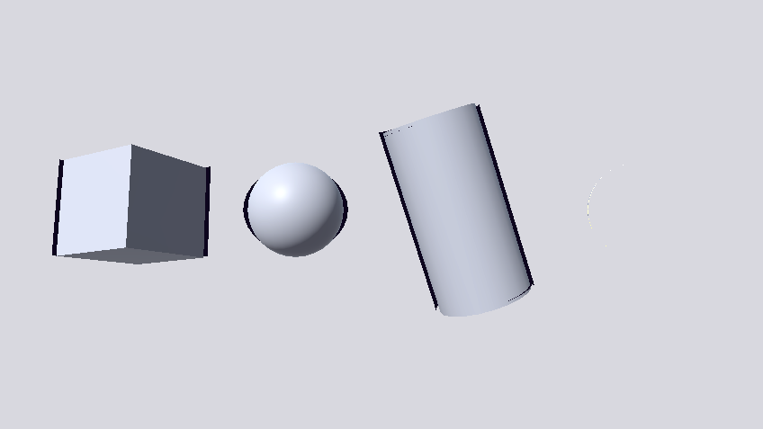

## 速览

>- **`discard` / `clip` 是片元着色器里唯一能"取消本次写出"的指令**，它不改几何：几何照旧提交、顶点照旧处理。所以它只能让**这一个 Pass** 的可见像素消失；阴影贴图、深度预处理、法线预处理是各自重新光栅化几何的，必须各自再判一次。
>- **"逐渐消失"的数学形式是一族嵌套集合**：可见集 `V(T) = { p | F(p) < T }`。只要阈值 `T` 随进度参数单调递增，集合就只减不增 —— 这是免费的，不需要任何状态。
>- **标量场 `F` 必须定义在"跟随物体"的坐标系里，并把值域归一到 `[0,1]`**：前者决定图案会不会随物体移动被"洗掉"，后者决定进度参数能不能线性地走完全程。**等值面的形状**（平面族还是球面族）决定"从哪里开始消失"。
>- **噪声的职责是"扰动边界"，所以阈值映射必须在两端各留出至少一个扰动半径的余量**：不留余量时，`Amount = 0` 会残留一圈噪声边缘、`Amount = 1` 会被啃出稀疏缺口。这两端的余量是设计出来的，不是调参调出来的。
>- **裁切线和过渡带必须共用同一个不等式**：只要它们来自同一个 `(T, t)`，零点就是同一条等值线，发光带不可能"漂"到保留区中间。幂函数（如 `Pow4`）只改变**分布形状**，不改变发光带的支撑集宽度。
>- **顶点插值只能重建"逐三角形仿射函数"**：非仿射的场（例如距离场）用逐顶点插值得到的是它的弦；在低模上弦可能退化成常数，于是整面同时越过阈值 —— 这不是精度问题，是表达能力不匹配。

## 1. `clip` / `discard`：片元级的二值化算子

**是什么。** `discard`（HLSL 里常通过内建函数 `clip` 使用）是**片元着色器**里唯一一条能取消"这次片元写出"的指令。它属于"光栅化之后的逐片元阶段"，作用域是**一次片元调用**，既不改变顶点数据，也不改变三角形，更不会影响别的 Pass。

```hlsl
// clip 的语义：任一通道 < 0 就丢弃当前片元
clip(threshold - field);
```

**取值与语义。** 要点只有几条，但每条都有实际后果：

| 写法 | 含义 |
|---|---|
| `clip(x)` | `x` 任一通道 `< 0` 时丢弃片元；等价于 `if (x < 0) discard;` |
| `clip(x)` 的存活条件 | `x >= 0`（等号归属见 §4 的边界说明） |
| `discard` 之后 | 不写颜色（RT0..RTn）、不写深度、不写模板，也**不参与混合**；该片元调用的后续语句不再执行 |
| 可用阶段 | 只能在**片元**（像素）着色器里；顶点着色器没有 `discard` |
| 与 `return` 的区别 | `return` 是正常结束，缓冲区**照写**；`discard` 是撤销写出 |

一个常见误区是把它当成"删掉几何"。它删不掉任何东西 —— 三角形、顶点着色、图元装配、光栅化全都照常发生，只是"写缓冲"这一步被撤销。

**底层机制。** 要理解它的能力边界，得看管线里"谁是像素的最终裁决者"。顶点着色器只决定"三角形投影到屏幕上的什么位置"，它对"三角形内部的哪一点该被画出来"没有发言权；光栅化把三角形拆成片元之后，**片元着色器才是唯一能按像素粒度决定写不写的地方**。想在像素粒度上雕刻形状，就只能在片元阶段做。

`discard` 的代价主要落在两处：

1. **填充率。** 片元着色器一旦可能 `discard`，硬件通常就不能再无条件地走"先做深度测试、把注定不写深度的片元提前剔除"的快路径。逻辑上提前剔除多数情况仍然安全，但分层深度（Hi-Z）一类的快速路径对"可能不写深度的片元"会退化成更保守的策略，典型后果是**同一 draw call 里被提前剔除的片元变少**，实际被着色的片元变多。这就是 alpha test / 溶解这类效果的填充率开销通常高于同等像素量的纯不透明绘制的原因（各实现策略不同，属"通常如此"而非规范保证）。
2. **顶点与图元开销一分不省。** 一个被 `F(p) > T` 全部覆盖的物体，依然要跑完顶点着色、裁剪、三角形装配，才轮到片元阶段批量丢弃。想省这部分只能靠 CPU 侧剔除，或者换 LOD。

**现象与边界。**

- **边界一：它不让几何一起消失。** 被 `discard` 的片元不写深度，所以在**同一个 Pass** 里，掏空处确实不再遮挡后面的东西。但阴影贴图和深度预处理是**另外的 Pass**，它们会重新光栅化同一份几何，看不到这里发生的任何事（详见 §7）。
- **边界二：它是硬边。** `discard` 的判据只有"留 / 不留"两种结果，没有中间态。想要软边就得自己造过渡带（§5），或者改用 alpha 混合。
- **边界三：和 alpha 混合是两条不同的路，不能混用。** 两者都能让物体"变没"，但机制完全不同：

| | `discard` / alpha test | alpha 混合 |
|---|---|---|
| 队列 | 可以留在不透明队列 | 必须进透明队列 |
| 深度 | 可以写深度，遮挡关系正确 | 通常 `ZWrite Off`，不写深度 |
| 边界 | 硬（除非另造过渡带） | 软，由 alpha 决定 |
| 排序 | 不敏感 | **敏感**：混合不可交换，必须从远到近 |
| 开销 | 可能有额外的填充率代价 | 每个片元都要着色并混合 |

## 2. 标量场 + 阈值：用等值线扫描做"集合裁剪"

**是什么。** 把"物体逐渐消失"表达成一个**参数化的集合**：在物体表面上定义一个标量场 `F`（给每个表面点一个实数），再给一个阈值 `T`，规定"场值小于阈值的地方可见"。上面 §1 的那行 `clip` 就是它的实现：

```text
可见集  V(T) = { p | F(p) < T }
等价写法 clip(T - F(p))        // F < T  <=>  T - F > 0
```

**取值与语义。**

- `F` 的定义域是**物体表面**（实际实现里通常是"片元所在的物体空间点"）。
- `T` 是唯一随进度变化的量。**"溶解进度"就是 `T` 的扫描**：`T` 从低于 `F` 的下界走到高于上界，可见集从全集走到空集。
- 当 `F` 的值域被归一到 `[0,1]` 时，`T` 的扫描区间也是 `[0,1]` 的一个仿射像（§4 会给准确的映射）。

**底层机制。** 这个模型有三个漂亮的代数性质，它们解释了为什么这套写法几乎成了标准做法：

1. **嵌套性（单调性）。** `T` 单调递增 ⇒ `V(T₁) ⊆ V(T₂)` 当 `T₁ < T₂`。也就是说溶解是一族**只减不增**的集合，永远不会出现"已经消失的地方又长回来"。这条性质**免费**：不需要记录状态、不需要特判，只要 `F` 与 `T` 都不含随进度非单调变化的量。一旦有人往 `T` 里塞进一个随进度转动的相位之类的非单调项，嵌套性立刻破坏，画面上就会出现"退回"的闪烁。
2. **无状态。** 整个效果的状态就是一个标量 `T`（加几个形状参数）。它不依赖上一帧、不依赖绘制顺序、不依赖任何 CPU 侧数据，所以天生可以并行、可以逐实例不同、可以随意时间轴倒放。
3. **边界推进速度由场的梯度决定。** 可见集的边界就是等值面 `F = T`。`T` 增大 `δT` 时，等值面沿其法向（`∇F` 方向）平移的距离是 `δT / |∇F|`：

```text
边界位移 = δT / |∇F|
=> |∇F| 恒定  =>  边界匀速推进  =>  "进度走多少，边界就走多少"
=> |∇F| 变化  =>  边界在梯度小的地方跑得快，大的地方跑得慢
```

这条式子把"值域归一"和"视觉节奏"联系了起来：§3 里两个常用的场都恰好有**恒定**的 `|∇F|`，这不是巧合，而是"让进度参数线性对应边界位移"的设计要求。反过来，凡是靠 `saturate` 把超出值域的部分钳掉的地方，`∇F` 就是 0 —— 边界会在那里**停住**，进度参数继续走但画面不动。

**现象与边界。**

- **边界一：`F` 必须在空间上连续。** 如果 `F` 是"逐顶点算完再插值"的（§6），它的连续性只到三角形粒度，边界会出现与网格拓扑相关的台阶。
- **边界二：等值面必须与表面相交。** 如果 `F` 在物体表面上根本没有穿过某个阈值（比如球心被放到网格外），那么对应的"一半溶解"状态就不可达。
- **边界三：`T` 的推进速度不等于"体积消失的速度"。** 边界是按**距离**推进的，而剩余体积按**距离的三次方**变化（对近似球状物体），所以 `Amount = 0.5` 时通常只吃掉了 10% 出头的体积。想要"体积匀速"就得给 `Amount` 走一条曲线。

## 3. 标量场的选取：坐标系、值域与等值面形状

**是什么。** `F` 是这套方法里唯一需要美术参数化的部分，它由三件事决定：**在哪个坐标系里度量**、**值域怎么归一**、**等值面长什么形状**。

**取值与语义。** 两种最常用的场：

```hlsl
// 场 A：仿射场 —— 沿某个轴的线性函数，等值面是一族平行平面
half Field_Linear(float3 positionWS, float3 axisOS, float3 originOS, float radius)
{
    float3 offset = TransformWorldToObject(positionWS) - originOS;
    return saturate(0.5h - dot(offset, axisOS) * rcp(max(radius, 1e-5)));
}

// 场 B：距离场 —— 到某点的距离，等值面是一族同心球面
half Field_Radial(float3 positionWS, float3 originOS, float radius)
{
    float3 offset = TransformWorldToObject(positionWS) - originOS;
    return saturate(1.0h - length(offset) * rcp(max(radius, 1e-5)));
}
```

| | 仿射场 `0.5 − offset·axis/R` | 距离场 `1 − |p−O|/R` |
|---|---|---|---|
| 等值面 | 平面族（垂直于 `axis`） | 球面族（以 `O` 为心） |
| 对坐标的解析性质 | **仿射**（线性 + 常数） | **凹**（范数凸，取负后凹） |
| 能否被逐顶点插值精确重建 | 可以，**精确** | 不可以，只能得到弦（§6） |
| `F = 1` 的位置 | 一整片平面 | **只有一个点** |
| `F = 0` 的位置 | 另一端的一整片平面 | 距 `O` 最远的一圈 |

最后两行是"手感"的来源：仿射场的 `F = 1` 落在一整片平面上，所以溶解一开始就是"吃掉一整层"；距离场的 `F = 1` 只落在一个点上，所以它必然从"无"→"一个点"→"一个小球"长出来，**不可能**一上来就有一个有面积的洞。这是等值面形状决定的固有边界，不是参数没调好。

**底层机制（一）：为什么度量必须在物体空间。** `positionWS` 是世界坐标，但场一定要先变换回物体空间再算：

```text
世界空间度量：中心是"世界上一个固定的点"
  => 物体平移时等值面不动 => 图案从物体表面"流过"（洗掉）
  => 物体旋转时 offsetWS.x 不再是"物体自身的 X 轴" => 图案在表面上滑动

物体空间度量：中心是"物体上的一点"
  => 图案是网格上的静态图案，世界变换完全不影响它
```

对成千上万个各自带变换的实例（GPU Instancing / 批渲染）来说，世界空间度量还有一个致命问题：场是按世界坐标定义的，**所有实例共享同一个场**，无法让每个物体各自从自己的中心开始溶解。物体空间度量则天然逐物体独立，代价是每个片元多一次 `TransformWorldToObject`（一次 3×4 矩阵乘）。

顺带一个推论：`R` 与 `O` 都是**物体单位**，所以物体的世界缩放不影响图案 —— 两者被同比例放大。这也意味着这两个参数必须由工具按网格的包围盒生成：美术资源的 pivot 经常不在包围盒中心（船模 pivot 在船尾），手填一个 `(0,0,0)` 会让球心跑到网格外面去。

**底层机制（二）：为什么值域要归一到 `[0,1]`。** 先看仿射场。设网格沿 `axis` 的完整尺寸是 `S`，则 `offset·axis ∈ [−S/2, +S/2]`。要让 `F` 在这段行程上恰好走完 `[0,1]`：

```text
F(+S/2) = 0.5 - (S/2)/R = 0
F(-S/2) = 0.5 + (S/2)/R = 1
两式等价：  (S/2)/R = 0.5  =>  R = S
```

也就是 **`R` 必须取该轴的完整尺寸**（不是"一半尺寸"）。填错的后果可以精确算出来：若 `R = S/2`，则 `(S/2)/R = 1`，`F` 的公式值域变成 `[−0.5, +1.5]`，被 `saturate` 钳掉：

| 行程区段 | 公式值 | 钳位后 | 现象 |
|---|---|---|---|
| `F > 1` 那 1/4 行程 | `(1, 1.5]` | `1` | **死区**：进度在走，边界不动 |
| 中间 1/2 行程 | `[0, 1]` | 正常 | 正常的溶解过程 |
| `F < 0` 那 1/4 行程 | `[−0.5, 0)` | `0` | **死区**：同样推不动 |

参数行程被压缩到一半，两端各多出一段"调了没反应"。这类"调参无响应"的 bug 靠观察很难定位，靠值域推导一行就能查出来。

再看距离场。`F = 1 − |p−O|/R` 在包围体上降到 0，需要 `R` 等于包围体内离 `O` 最远的距离；`O` 取包围盒中心时，这就是**半对角线** `extents.magnitude`。但这里有个反直觉的边界：**距离场的行程上限常常用不满**。

```text
R = 包围体内 max|p - O|
=> 包围体内 F >= 0            （saturate 兜住，不会出现负值）
=> F = 1 只发生在 p = O 这一个点
=> 若 O 不在网格表面上（很常见），表面上 max F = 1 - d_min/R < 1
```

举个能精确算的例子：Unity 内置 Cube 是 `1×1×1`，8 个顶点在 `(±0.5, ±0.5, ±0.5)`，`0.5·√3 ≈ 0.8660`。取 `O = (0,0,0)`、`R = 0.8660`，则顶点处 `F = 0`，面心 `(0,0,±0.5)` 处 `F = 1 − 0.5/0.8660 = 0.4226` —— 整个表面上 `F ∈ [0, 0.4226]`，最大值只到 0.42。也就是说 Cube 的径向溶解是**从面心开始**、向 8 个角收缩。这组数字 §6 还会再用一次。

**底层机制（三）：两个场的梯度都是常数。**

```text
仿射场：∇F = -axis / R                =>  |∇F| = 1/R
距离场：∇F = -(p - O) / (R·|p - O|)   =>  |∇F| = 1/R
```

两者都是常数，所以在 `saturate` 还没开始钳位的区间里，**边界是匀速推进的**（§2 的结论）。这正是"值域归一"的第二层含义：不只是"把范围铺满"，而是让**进度与空间位移成正比**。凡是超出 `[0,1]` 被钳掉的地方 `|∇F| = 0`，边界就停住 —— 这就是上面那张死区表的本质。

**现象与边界。**

- `O` 必须用工具按包围盒生成，手填会偏；同一材质被多个 mesh 共用时，`O` 只能匹配其中一个。
- `R` 填小于实际尺寸 ⇒ 两端死区；填大于实际尺寸 ⇒ 表面上 `F` 到不了 0/1，溶解永远走不完（也会看到"进度到头了物体还没全没"）。
- 距离场在 `F = 1` 处退化成一个点，所以它对"从哪里开始"极其敏感；仿射场的起点是一整片，容错高得多。



*距离场（径向）溶解的中间态：边界的形状就是等值面的形状 —— 一圈以起点为心的球面等值线，从中心向外扩张。*

## 4. 噪声与阈值映射：为什么要给扰动留余量

**是什么。** 一条光滑的等值线看起来太"干净"，所以实践中会加一层噪声：把噪声采样值以 0 为中心、按强度缩放后**加到场值上**，让边界变成不规则的碎边。同时，进度参数到阈值之间需要一个**映射**。这一节要说明的是：这个映射不是随手写的线性函数，它必须把噪声的幅度算进去。

```hlsl
half ApplyDissolve(half field, float2 uv)
{
    half amp       = _NoiseStrength;                     // 噪声强度
    half threshold = _Amount * (1.0h + amp * 2.0h) - amp - _Cutoff;

    half phase = frac(_Time.y * 0.5);
    half noise = SAMPLE_TEXTURE2D(_NoiseMap, sampler_NoiseMap,
                                  uv * _NoiseScale + phase).r;
    half t     = field + (noise - 0.5h) * amp;           // 噪声只加在场值上
    clip(threshold - t);

    half edge = saturate((threshold - t) * rcp(max(_EdgeWidth, 1e-4)));
    return Pow4(edge);
}
```

**取值与语义。**

```text
amp   = _NoiseStrength   0..1，典型 0.25        c = _Cutoff，典型 0
a     = _Amount          0 = 全空，1 = 全显     n = 噪声贴图 R 通道 ∈ [0,1]
field = 场值             ∈ [0,1]（saturate 保证）
```

两点值得单独指出：

- **噪声是加在"场值"上、不是加在"阈值"上的。** 这就是"噪声只负责扰动边界"的实现方式：它的作用等价于沿等值线的法向做随机位移，位移量由 `amp` 控制。它不该改变推进方向，也不该改变判据的形式。
- **采样只取一个通道**（这里取 `.r`）。噪声贴图不需要 4 个通道各放一套噪声；单通道足够，而且省带宽。

**底层机制：先把扰动的实际幅度算清楚。** `(n − 0.5)·amp` 的减 0.5 中心化写法说明它想表达"以 0 为中心、幅度正比于 `amp` 的扰动"。实际值域是：

```text
n ∈ [0, 1]  =>  (n - 0.5) ∈ [-0.5, +0.5]  =>  扰动 ∈ [-amp/2, +amp/2]
```

**关键在 `amp/2` 而不是 `amp`**：`amp` 是输入噪声的幅度缩放，实际扰动半径只有它的一半 —— 因为 `n` 的值域宽度是 1，中心化后又折了一半。后面所有的余量都是 `amp/2`，根子在这一行。于是保留条件是：

```text
t = field + 扰动,    t ∈ [-amp/2, 1 + amp/2]
保留  <=>  t < threshold
```

**第一步：先看朴素做法为什么错。** 最自然的想法是"阈值就是进度"，即 `threshold = a`：

```text
若 threshold = a：
  a = 0:  保留 <=> t < 0。取 field = 0（最有利的片元）且 n = 0（扰动 = -amp/2）：t = -amp/2 < 0
          => 这些片元活下来！"已全空"却残留一圈噪声边缘
  a = 1:  保留 <=> t < 1。取 field = 1（最不利的片元）且 n = 1（扰动 = +amp/2）：t = 1 + amp/2 > 1
          => 这些片元被切掉！"应全显"却被啃出稀疏缺口
```

两端都漏。这不是精度问题，是**判据本身的位置错了** —— 它没有把扰动的幅度算进去。

**第二步：把要求写清楚，反解映射。** 设 `D = amp/2` 为扰动半径：

```text
要求 1（a = 0 全空）:  threshold(0) < t_min = -D
要求 2（a = 1 全显）:  threshold(1) > t_max = 1 + D
要求 3（映射对 a 仿射）:  threshold(a) = threshold(0) + a·(threshold(1) - threshold(0))
```

要求 3 是必要的：映射不仿射的话，同样的进度增量在不同区段会推进不同的距离，节奏就不均匀，而且没有理由引入这种非线性。若取"余量最小、最不浪费行程"的解（两端取等号）：`threshold(0) = −amp/2`、`threshold(1) = 1 + amp/2`，斜率 `= 1 + amp`，即 `threshold(a) = −amp/2 + a(1 + amp)`。

而不少实现里常见的映射留的是**每端 `amp` 的余量**，也就是所需余量的**两倍**：

```text
threshold(0) = -amp,   threshold(1) = 1 + amp   =>  斜率 = 1 + 2amp
=> threshold(a) = -amp + a(1 + 2amp) = a(1 + 2amp) - amp
```

而扰动半径只有 `amp/2`。两端各推一遍：

```text
a = 0:  t_min = 0 + (-amp/2) = -amp/2；threshold(0) = -amp
        t_min - threshold(0) = -amp/2 + amp = +amp/2 > 0    =>  严格没有片元存活 ✓
a = 1:  t_max = 1 + amp/2；threshold(1) = 1 + amp
        threshold(1) - t_max = (1 + amp) - (1 + amp/2) = +amp/2 > 0   =>  所有片元存活 ✓
```

两端余量**恰好都是 `amp/2`，对称**。这个 2 倍冗余不是浪费，有三个真实用途：

1. **远离判据边界。** 只取一端等号就正好压在 `clip` 的边界上；而 `clip` 的等号归属（`x >= 0` 存活还是 `x > 0` 存活）属于实现细节。留 2 倍余量让两端都**远离**边界，与等号约定无关。
2. **给偏置参数留出行程。** `_Cutoff` 是一个双向偏置，只有两端余量为正时才能往两个方向拧而不破坏两端干净。
3. **对强度变化鲁棒。** 噪声强度往往可以被上层改写（逐材质、逐实例、甚至运行时动画）。当它被调到接近 1 时，扰动半径涨到 0.5，而两端余量（`amp`）同步涨到 1，依然完整覆盖。

**第三步：偏置项的严格条件。** `threshold` 里的 `− c` 把整个阈值区间 `[−amp, 1+amp]` 平移 `−c`（正 `c` 让阈值变小）：

```text
a = 0 全空  <=>  threshold(0) = -amp - c  <  t_min = -amp/2    <=>  c > -amp/2
a = 1 全显  <=>  threshold(1) = 1 + amp - c > t_max = 1 + amp/2 <=>  c < +amp/2
=>  c ∈ (-amp/2, +amp/2)         把端点等号一起写： c ∈ [-amp/2, +amp/2)
```

（"保留"取 `t <= T` 还是 `t < T` 只影响测度为零的等值线，两种约定的括号方向刚好互补。）默认 `amp = 0.25`、`c = 0` 时区间是 `[−0.125, +0.125)`，成立。这就是"两端干净"的**充要条件**，也是一条实用的调试线索：**只要把偏置拧出这个区间，两端必然不干净**，而且症状可预测：

| `c` 的取值 | 破坏哪端 | 症状 |
|---|---|---|
| `c < −amp/2` | `a = 0` | "已全空"时仍残留零星噪声碎块 |
| `c >= +amp/2` | `a = 1` | "应全显"时仍被啃掉最不利的片元，边缘出现稀疏缺口 |
| `c ∈ [−amp/2, +amp/2)` | 都不破坏 | 两端干净，`c` 表现为边界的前后偏置 |

**代入数值查一遍**（`amp = 0.25`、`c = 0`，扰动半径 `±0.125`）：

| `a` | `threshold = a(1+2amp) − amp` | 阈值侧余量 | 结果 |
|---|---|---|---|
| `0` | `−0.25` | 比 `t_min = −0.125` 低 `0.125` | **全空**（无片元满足 `t < T`） |
| `0.5` | `0.5` | — | 约 `field < 0.5` 的部分被吃，边界在 `field ≈ 0.5` 附近扰动 |
| `1` | `1.25` | 比 `t_max = 1.125` 高 `0.125` | **全显**（无片元被切） |

**现象与边界。**

- **噪声贴图是"无扰动"时，两端干净是平凡的。** 单通道灰度贴图若退化成常量 `0.5`，扰动恒为 0，`t = field`，边界就是一条干净的等值线。要碎边必须换一张真正的噪声图。
- **偏置的正负方向容易记反。** `threshold = a(1+2amp) − amp − c` 里正的 `c` 让阈值**变小** ⇒ 同一进度下保留区更小 ⇒ 边界更靠 `field` 小的一端 ⇒ **`field = 1` 那一端先没**。有些实现或文档把它描述成"正 = 更晚溶解"，方向正好相反；以公式为准。
- **`amp = 0` 时偏置必须严格为 0。** 此时余量为 0，条件退化成 `c ∈ [0, 0)`，任何非零偏置都会让某一端漏。
- **噪声是"位置域"的扰动，不是"时间域"的。** 它随 UV 移动（§8），所以同一个物体的图案会流动；这也意味着它不能用来做"逐物体差异化" —— 逐物体差异要靠参数，不是靠 UV。

## 5. 过渡带与裁切线共线；幂函数的分布整形

**是什么。** "溶解边缘发光"这类效果需要一条**沿着裁切线布置的过渡带**。它的实现要点只有一句：**过渡带和裁切线必须由同一个不等式定义**。

```hlsl
clip(threshold - t);                                                  // 裁切线：threshold - t = 0
half edge = saturate((threshold - t) * rcp(max(_EdgeWidth, 1e-4)));   // 同一个自变量
return Pow4(edge);
```

**取值与语义。** 令 `x = saturate((T − t)/w)`，其中 `w = _EdgeWidth`：

| `T − t` | `x` | `edge` | `glow ∝ (1 − edge)` | 位置 |
|---|---|---|---|---|
| `→ 0⁺`（刚好越过裁剪线） | `→ 0` | `→ 0` | `→ 1` | 发光最强 |
| `0.5 w` | `0.5` | `0.0625` | `0.9375` | 仍在发光 |
| `0.9 w` | `0.9` | `0.6561` | `0.344` | 发光开始衰减 |
| `>= w` | `1` | `1` | `0` | 保留区内部，不发光 |

`edge` 的语义是"离边界有多远"：**0 = 紧贴裁切线，1 = 完全处于保留区内部**。所以 `_EdgeWidth` 的单位是**场值空间**（和 `field` 同量纲）。另外，被 `clip` 掉的片元连 `edge` 都拿不到 —— 发光只可能出现在存活片元上，这是"两端干净"能顺带保证"两端不残留发光"的原因。

**底层机制（一）：为什么必须是同一条等值线。** 裁切线是集合 `{ p | T − t(p) = 0 }`。`edge` 的零点也是同一个集合 —— 因为它的自变量**就是** `T − t`，字面意义上的同一个表达式：

```text
裁切线 = { p | T - t(p) = 0 }
edge = 0 = { p | T - t(p) = 0 }        （同一个集合）
```

第一，发光带永远贴着边界，不可能"漂"到保留区中间，也不可能跑到被裁掉的区域里去。第二，只要 `T` 和 `t` 本身在流动（时间动画、参数变化、逐实例差异），两者**同步**变化，不变量自动保持。

如果改成"另算一套判据" —— 比如用世界空间到某个参考面的距离、或者用**没有加噪声的场值** `field` 而不是扰动后的 `t` 来算过渡带 —— 那么两套判据的零点是**两条不同的等值线**：`field` 的等值线和 `field + 扰动` 的等值线在噪声强的地方可以差出 `amp/2` 的空间距离（§4）。结果是发光带从边界上"漂"开：有的地方跑到被裁掉的区域里（看不见），有的地方跑到保留区深处（变成一片内部光晕）。**这个失效是静默的**：不报错、不警告，只是发光位置不对。

**底层机制（二）：`Pow4` 到底改了什么。** 幂函数是分布整形工具。把"没有 `Pow4`"（`edge = x`）与现状（`edge = x⁴`，`Pow4(x) = (x·x)·(x·x)`，见 URP Core `Common.hlsl:901`）并排算：

| `x` | `edge = x` | `edge = x⁴` | `glow = 1 − x` | `glow = 1 − x⁴` |
|---|---|---|---|---|
| `0.0` | `0` | `0` | `1` | `1` |
| `0.25` | `0.25` | `0.0039` | `0.75` | `0.996` |
| `0.5` | `0.5` | `0.0625` | `0.5` | `0.9375` |
| `0.75` | `0.75` | `0.3164` | `0.25` | `0.684` |
| `0.9` | `0.9` | `0.6561` | `0.1` | `0.344` |
| `1.0` | `1` | `1` | `0` | `0` |

先把**不变**的东西说清楚：发光带的**支撑集**宽度严格是 `w`（两种写法都在 `x >= 1` 处归零），`Pow4` 不改变这条带宽。而且对任一阈值 `ε ∈ (0,1)`，集合 `{ x | glow >= ε }` 在 `Pow4` 下都**更大**（更贴近内边界）—— 所以"有发光"的区域是变大而不是变小，`Pow4` 从来不是在"缩小发光面积"。

被改变的是**分布的形状**。把 `glow` 从 0.9 掉到 0.1 所跨的区间：线性写法跨 `x ∈ [0.1, 0.9]`（带宽的 80%），`Pow4` 只跨 `x ∈ [0.562, 0.974]`（约 41%）。用半衰点看更干净：`1 − x⁴ = 0.5` 给出 `x = 0.8409`，也就是**带宽靠近裁切线的前 84% 亮度都在 0.5 以上，亮度从 0.5 掉到 0 只用了最后约 16% 的带宽**；线性写法是 50% / 50%。所以 `Pow4` 真正做的是**把亮芯压向裁切线、把衰减收成靠近内侧的一道窄收尾**，让发光的"重心"落在边界上，而不是铺成一整片缓慢下降的中低亮度。

这是一条可以推广的结论：**幂函数 `pow(x, k)`（`k > 1`）只改变分布形状，不改变支撑集**。`k` 越大，高值区越向 `x` 小的一侧集中、低值区的收尾越陡。想改变"带宽"本身，要改的是 `w`，不是指数。

**现象与边界。**

1. **`w` 太大时整块表面会浮起一层光。** `a = 1` 时保留区内 `T − t` 的最小值是 `amp/2 − c`。若 `_EdgeWidth > amp/2 − c`（典型配置 `0.08 < 0.125`，恰好安全），`x` 在整块表面上都小于 1，`glow > 0` 遍地都是。想要"大范围发光"又要"干净收尾"，得同时加大噪声强度（抬高 `amp/2`）或把偏置调负（抬高 `amp/2 − c`）。
2. **`w` 读到 0 时过渡带会塌缩。** `rcp(max(_EdgeWidth, 1e-4))` 把宽度兜到 `1e-4`，于是 `x` 几乎立刻饱和到 1、`glow ≈ 0`：过渡带塌成亚像素、实际不可见。注意这与上一条**方向相反** —— 不是"糊掉"，是"没了"。属性未被写入（例如逐实例数据缺省）时正是这个症状。
3. **幂函数只是缓解，不是免疫。** 它不能阻止第 1 条，只能把"糊亮"的分布形状改得更像一圈硬边。

顺带一个和 HDR 相关的边界：边缘发光通常以 `emission += color.rgb * color.a * (1 − edge)` 的形式**叠加**到自发光上。颜色用 HDR（分量可以大于 1）才能被 Bloom 抓到；而 `rgb * a` 的写法让 alpha 直接当强度旋钮 —— `a = 0` 时无论 `rgb` 多大都不发光，这正是"属性默认值即关闭态"的实现方式。

## 6. 顶点插值的表达能力：只能重建仿射函数

**是什么。** 这一节讲一条与溶解无关、但决定了"低模上能不能用逐顶点方案"的通用图形学结论：**光栅化阶段的 varying 插值，在表达能力上等价于"逐三角形的仿射函数"**。任何非仿射的量用逐顶点方式传递，得到的都不是它本身，而是它的弦。

**取值与语义。** 顶点着色器为每个顶点输出一组 varying；光栅化在三角形内部做**透视校正插值**。透视校正的准确含义是：插值权重等于片元在**三角形三维空间**里的重心坐标。于是对任意 varying `g`：

```text
硬件重建出的函数  g̃(p) = λ1(p)·g(v1) + λ2(p)·g(v2) + λ3(p)·g(v3)，Σλi = 1
```

`λi(p)` 是 `p` 的**仿射**函数，所以 `g̃` 是仿射函数。由此得到精确刻画：若 `g` 在该三角形上仿射，则 `g̃ ≡ g`（**完全精确**）；否则 `g̃` 是 `g` 的**弦**（chord），即唯一一个在三顶点上与 `g` 相等、且在整个三角形上仿射的函数。一句话：**逐顶点传递的信息量是"每个三角形 3 个自由度"**，它丢掉的永远是"三角形内部的曲率信息"。

**底层机制：弦在曲线的哪一侧。** 对凸函数，弦在曲线**上方**；对凹函数，弦在曲线**下方**。前面 §3 的两个场正好分属两类：

```text
仿射场  0.5 − offset·axis/R   ：仿射 => 弦就是它自己 => 逐顶点精确
距离场  1 − |p−O|/R           ：凹（范数凸，取负后凹）
        => f(Σλi·vi) >= Σλi·f(vi) = g̃(p)   =>   g̃(p) <= f(p)，端点取等号
```

所以距离场用逐顶点方案会**系统性地低估**场值 —— 不是随机误差，是有符号的偏置；误差在三角形内部最大、在顶点处为零。误差的上界正是"该三角形上真实场的变化量"，而真实场的**极值点**（对距离场就是离 `O` 最近/最远的那个内部点）根本不在顶点上：**采样点恰好避开了它想表达的那个结构**。

**Cube 上把数字算出来。** Unity 内置 Cube 是 `1×1×1`，8 个顶点 `(±0.5, ±0.5, ±0.5)`，`0.5√3 ≈ 0.8660`。取 `O = (0,0,0)`、径向 `R = 0.8660`：

```text
顶点 v:      f(v) = 1 - 0.8660/0.8660 = 0        ← 8 个顶点全部为 0
面心 (0,0,±0.5): f = 1 - 0.5/0.8660 = 0.4226      ← 真实场的最大值
逐顶点：每个三角形的三个顶点值全是 0  =>  g̃(p) ≡ 0
插值误差 = 0.4226 = 该面上真实场的全部变化量（100% 损失）
```

这不是"精度不够"，是**信息量为零**：顶点采样恰好落在场的一个等值面上，面内的一切结构（整个梯度）对顶点采样器不可见。用默认参数（`amp = 0.25`、`c = 0`、噪声贴图退化成常量 0.5 即无扰动）推一遍，此时 `t = field`、`threshold(a) = 1.5a − 0.25`，存活 `⟺ field < 1.5a − 0.25`：

```text
逐顶点（g̃ ≡ 0）:
  存活 <=> 0 < 1.5a - 0.25 <=> a > 1/6 ≈ 0.167
  => a <= 1/6 整个 Cube 完全不可见；a > 1/6 整个 Cube 一次性全部出现
  => 过渡区间宽度 = 0，是一帧硬切

逐片元（field 取真值：面心 0.4226、角点 0）:
  a <= 1/6    : 无片元存活（连 field = 0 的角点也不满足严格小于）
  1/6 < a     : 8 个角点附近的长条区最先活下来
  a > 0.4484  : 面心也活了（0.4226 < 1.5a - 0.25）=> 整个表面可见
  => 过渡区间宽度 ≈ 0.28，边界从面心向角点推进
```

也就是：**逐顶点把一条 0.28 宽的推进过程压成了一帧开关**。这个结论不依赖噪声：无扰动时就是这样，换成真噪声图也只是把"硬切"变成"整块同时按噪点侵蚀"，**依然没有空间顺序**。（这两个数值是解析推算，未实跑。）

**现象与边界。**

- **凡是"逐顶点算标量、片元比较阈值"的方案，都受这条约束。** 它不只影响溶解，同样影响雾、逐顶点光照、屏幕空间距离衰减等一切"非线性量走 varying"的场合。
- **逐片元方案的 `positionWS` 插值本身是精确的。** 透视校正插值把片元还原成三角形上的真实三维点，所以"在片元里用世界坐标反算物体空间点、再算场"得到的是场的**真值**。逐顶点丢掉的恰恰是场在三角形内部的结构 —— 这不是"更精细的近似"，而是"精确 vs 结构性错误"的区别。
- **什么时候逐顶点够用？** 只有两种情形：(a) 场本身仿射；(b) 网格密到弦误差小于一个像素对应的场值差。但 (b) 没有固定阈值 —— 弦误差正比于**曲率 × 边长²**，同一句话在小方块上错得离谱、在十万面的网格上可以忽略。既然判据依赖网格，就不该把它做成需要美术判断的开关。
- **代价对比。** 逐片元只多一次坐标变换与一次 `rcp`（按片元），换来的是"所有 Pass 共用同一个世界坐标插值器就能算出唯一正确的边界"。

## 7. 多 Pass 自洽：`discard` 不会传播

**是什么。** 同一个网格通常会被**多个 Pass** 分别光栅化。`discard` 的作用域只有一次片元调用，它不会以任何形式"告诉"别的 Pass。所以"物体消失了"这件事必须在每个 Pass 里**独立重新推导一遍**。

**取值与语义。** 常见的 Pass 角色（以 URP 的 `LightMode` 标签为例）：

| 典型角色 | `LightMode` | 输出到哪里 | 决定什么 |
|---|---|---|---|
| 颜色（前向） | `UniversalForward` | 颜色缓冲 | 可见像素 |
| 阴影投射 | `ShadowCaster` | 阴影贴图 | 投影 / 自阴影 |
| 深度预处理 | `DepthOnly` | 深度缓冲 | SSAO、软粒子、SSR、深度雾 |
| 法线预处理 | `DepthNormals` | 法线缓冲 | SSAO / 屏幕空间效果的几何项 |
| 轮廓外壳 | `SRPDefaultUnlit` 等 | 颜色缓冲（外扩几何） | 描边 |

每个 Pass 都是一次独立的"顶点 + 光栅化 + 片元"执行。`discard` 只决定"这次调用要不要写缓冲"，**不会**留下跨 Pass 可见的痕迹，也**不会**改变几何本身。

**底层机制。** 关键在于"这些缓冲是从几何重新生成的，而不是从颜色缓冲派生的"。阴影贴图是**从光源视角**重新光栅化一遍；深度预处理是**从相机视角**重新光栅化一遍但只写深度；法线预处理同理。既然每个 Pass 都把同一份几何重新过了一遍光栅化，那么"哪些片元该被丢掉"这个判断就必须在每个 Pass 里各做一次。

推论：所有 Pass 的判据必须**逐字同源** —— 同一个场函数、同一个插值出来的世界坐标（透视校正插值把它还原成三角形上的真实三维点）、同一个 UV 变换。任何一处不同（多一次变换、UV 变换不同、另一个时间戳），边界就不会重合。

**现象与边界：漏掉每个 Pass 的特征图像。** 因为分歧是"可见像素 vs 某个缓冲"，每种漏法都有一张可辨认的错图：

| 漏掉哪个 Pass | 缓冲里物体的状态 | 特征图像 |
|---|---|---|
| 阴影投射 | **实心** | 主体已被掏空，地面上的影子还是完整的实心影子，且形状完全不随溶解变化 |
| 深度预处理 | **实心** | 一个"幽灵遮挡体"：掏空处仍被认为有表面，SSAO 在空气里压出暗角、软粒子被不存在的表面挡住、深度雾把它当实体 |
| 法线预处理 | **实心** | SSAO / 屏幕空间几何效果在掏空区域仍按实心表面计算 |
| 轮廓外壳 | **完整** | 主体没了、描边还在，留下**空壳轮廓**（最容易被误判成"描边 bug"） |
| 颜色（反向） | **实心** | 主体还在，但影子和深度被掏空 |

> ⚠️ 这些错误**都不报错、不警告**。判断"要不要在这个 Pass 里加溶解"的方法不是看它画不画颜色，而是看它**是不是重新光栅化了同一份几何**。是，就得裁。


*同一组几何、多个 Pass 各自光栅化一遍：颜色 Pass 负责可见像素，轮廓外壳 Pass 负责描边。凡是重新生成几何的 Pass 都要自己判一次"留不留"，否则会留下空壳轮廓或实心阴影。*

**一个容易忽略的子问题：几何被位移过的 Pass，场要在哪个位置上求值。** 轮廓外壳会在顶点阶段把顶点沿法线推出去；阴影投射会给顶点加一个深度偏置（`ApplyShadowBias`，见 URP `Shadows.hlsl:468`）。这两处都让"同一个片元"对应**两个不同的空间点**：

```hlsl
float3 positionWS = TransformObjectToWorld(input.positionOS.xyz);   // 原始位置
float3 pushedWS   = positionWS + normalWS * offset;                 // 位移后
float4 positionCS = TransformWorldToHClip(pushedWS);                // 画在哪里用位移后
// 但场必须在**原始位置**上求值，才能和颜色 Pass 的边界重合
```

为什么不能偷懒用位移后的位置？因为场定义在**网格表面**上，位移后的点是它的外推。以仿射场为例，位移带来的场值偏差是

```text
F(pushed) - F(p) = -(n·axis)·offset / R
```

**偏差量随片元法线 `n` 变化**，不是一个可以统一补掉的常数。结果就是这些 Pass 的裁剪边界被"按法线方向不定量地推移"，与主体错开一条缝（外壳露出缝隙）或整体偏移一个偏置量（阴影边界与可见轮廓错位）。所以正确做法是：**决定画在哪用位移后的坐标，决定留不留用原始坐标**。

顺带一条成本契约：给某效果单独加的插值器应当和它的开关关键字绑在一起（条件编译），才能保证"效果关闭的变体完全不为它付费" —— 插值器占寄存器、占带宽、占顶点到片元的传输槽位。反过来也有陷阱：`Attributes` 里的输入语义也要用同一个条件包住，否则会出现"读到一个不存在的输入"这种静默失败。

## 8. 时间驱动：滚动采样坐标，而不是滚动阈值

**是什么。** 让溶解图案动起来有两条路：把时间加到**采样坐标**上，或者把时间加到**阈值**上。两者数学上都能让图案变化，但只有前者能在动画循环点上做到无缝。

```hlsl
half phase = frac(_Time.y * 0.5);                          // 周期 2 秒的锯齿波，值域 [0,1)
half noise = SAMPLE_TEXTURE2D(_NoiseMap, sampler_NoiseMap,
                              uv * _NoiseScale + phase).r; // 时间加在采样坐标上
half t     = field + (noise - 0.5h) * amp;                 // 同一个 t 同时喂给 clip 和过渡带
```

**取值与语义。**

- `_Time.y` 是引擎提供的连续时间（秒）。乘 `0.5` 表示"每秒滚过 0.5 个 UV 单位"，即贴图在物体表面上以 0.5 UV/秒平移。
- `frac` 取小数部分，把值域压回 `[0, 1)`，于是 `phase` 是一个**周期 2 秒的锯齿波**。
- `uv * _NoiseScale` 是空间频率：值越大噪声越细、碎块越小。

**底层机制（一）：为什么滚动采样坐标能无缝回绕。**

```text
方案 A（滚动采样坐标）:  n(uv + 1) == n(uv)     当贴图 Wrap Mode = Repeat 时成立
         => phase 从 1 回绕到 0 时，采样到的值完全不变 => 数学上连续，看不到接缝
方案 B（滚动阈值）:      threshold + 1  vs  threshold + 0
         => 噪声在"值域"上没有周期结构，回绕必然产生一次可见的整体跳变
```

关键在于**位移发生在哪个域**。UV 域被纹理的 `Wrap Mode` 显式周期化了，`phase` 的周期（1 个 UV 单位）可以与贴图周期严格重合，回绕点两侧的采样值相等；而值域没有这样的周期结构，任何"平移阈值"的时间动画在回绕处都必然跳变。

同时它守住了 §5 的不变量：`t` 变了，但裁切与过渡带用的是同一个变完的 `t`，两条判据的零点依然重合 —— 图案流动时，裁剪边界和发光带**严格同相**。

**底层机制（二）：`frac` 防的是什么漂移。** 如果直接把 `_Time.y * 0.5` 当 UV 偏移，它会随时间单调增长到很大。浮点数的有效位是固定的，数值越大绝对精度越差：一旦 `uv + offset` 让整数部分吃掉大部分有效位，`uv` 的小数部分就只剩少数几个可分辨台阶。表现是运行一段时间后采样图案出现**量化台阶 / 抖动**；而 mip 选择依赖的 UV 导数会更早坏掉（导数一旦失真，纹理细节层级就乱跳）。`frac` 把送进采样器的偏移折回 `[0, 1)` —— 正好是 UV 有效精度最密集、也是贴图一个完整周期的区间。

**现象与边界。**

- **贴图的 Wrap Mode 必须是 Repeat，且图案要能无缝平铺。** 否则每 2 秒（`phase` 回绕一次）会看到图案整体跳变一次。这条约束代码无法自证，只能靠资源设置保证。
- **`frac` 治的是"偏移无界"，不是"时间无界"。** 它作用在 `_Time.y * 0.5` 这个乘法**之后**：`_Time.y` 本身足够大时（`float32` 下要到 `10⁶ s` 量级）那次乘法就已经失真，`frac` 救不回来。（推算，未实跑。）
- **想区分不同物体，不能靠 UV，要靠参数。** 因为 `uv` 是网格上的位置，同一个网格的每个实例采样到的是同一张图案的同一处；逐物体差异只能来自被逐实例覆盖的参数（强度、频率、相位偏移等）。
- **缩放与平移都能加进采样坐标。** `uv * scale + phase` 是"缩放 + 平移"的一般形式；再叠一层旋转就是一个 2×2 矩阵。三者都不破坏 §5 的共线不变量，因为它们只改变 `t`，而 `clip` 和过渡带共用 `t`。

## 小结与延伸

把这篇的知识点串成一条链：

```text
想按像素粒度让物体消失
  -> 只能用片元阶段的 discard/clip；几何仍在，写出被撤销（§1）
  -> 于是可见集 = { p | F(p) < T }，T 单调扫描 => 嵌套、无状态（§2）
  -> F 必须定义在跟随物体的坐标系里、值域归一到 [0,1]、
     梯度恒定才能让边界匀速推进（§3）
  -> 噪声只扰动边界，所以阈值映射要在两端各留一个扰动半径的余量（§4）
  -> 过渡带复用同一个 (T, t)，零点与裁切线重合；
     幂函数只整形分布，不改带宽（§5）
  -> 非仿射的场不能被逐顶点插值表达，低模上必须逐片元（§6）
  -> discard 不跨 Pass 传播，每个重新光栅化几何的 Pass 都要自己裁（§7）
  -> 时间动画滚动采样坐标（可在周期域内无缝回绕），而不是滚动阈值（§8）
```

几篇配套文章：讲 Pass 与管线契约、`LightMode`、`Blend` 混合方程与关键字变体（`/blog/blog/customlit-passes/`），讲轮廓描边的几何原理（`/blog/blog/customlit-outline/`），讲菲涅尔与发射项在光照方程中的位置（`/blog/blog/customlit-rim-glow/`），讲关键字短路与 HDR / 逐实例数据分层（`/blog/blog/customlit-emission/`）。
