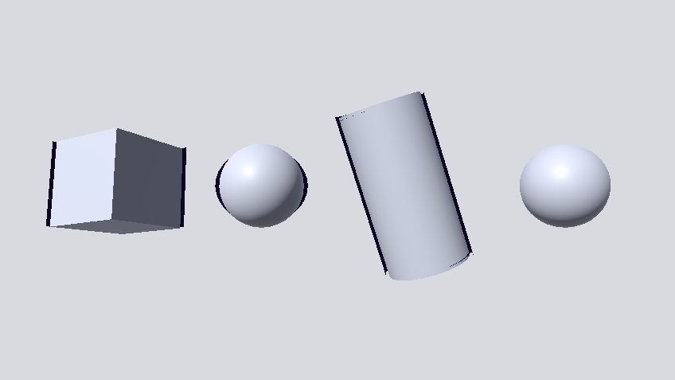
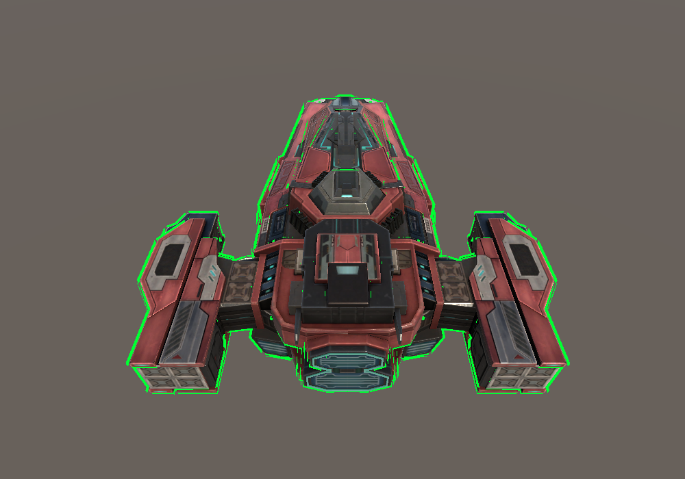
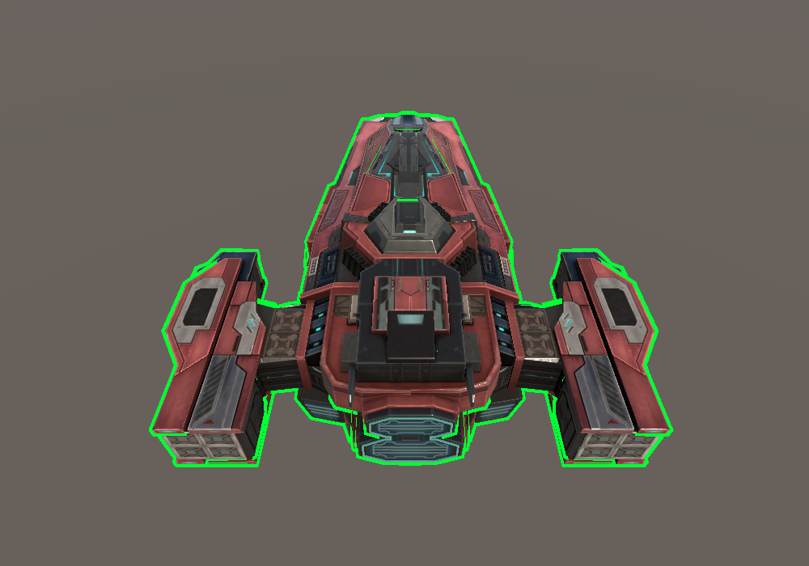

## 速览

>- **轮廓是"偏置面减去原剪影"的差集**：把网格沿外法向偏置 `d` 得到外壳，外壳的图像必然包住原剪影；再让深度测试把内部的归属判给主体，剩下的那一圈就是轮廓。`Cull Front` 在这里的角色是"**只要远的那一半**"这个选择器 —— 它不是风格选项，而是这套几何成立的前提。
>- **`p + d·n` 是等距偏置，`k·p` 是相似变换**，两者只在"球心在原点"这一种退化情形下重合。沿法线的偏置处处走 `d`、方向就是外法向；整体缩放的位移是 `(k-1)·|p|`、方向是径向。偏移面会折叠（凹处曲率半径小于 `d` 时），相似变换不会。
>- **"恒定像素宽度"不是屏幕空间技巧，是一条比例式**：`1 像素 @ 视深 z = 2·z·tan(fovY/2)/H` 个世界单位。所以 `d ∝ z` ⟺ 像素宽度恒定；正交投影没有 1/z 项，比例式退化成常数。
>- **`ZTest` 管"读"、`ZWrite` 管"写"**，是两个完全独立的状态。`ZTest` 决定新片元能否留下；`ZWrite On` 决定它是否把自己的深度留给后面的人。`ZWrite Off` 的像素深度保持清屏值，于是**任何**之后"写颜色、按深度测试"的全屏绘制都能把它盖回去 —— 天空盒是最常见的那个凶手。
>- **绘制顺序有两层，别混为一谈**：不透明排序（前到后、配合 early-Z 减少 overdraw）决定的是 **renderer 之间**的顺序，而它看不到同一个 renderer 内部的多个 Pass；同一 renderer 内 Pass 的先后由 **shader pass 槽位**（`DrawingSettings.SetShaderPassName` + `LightMode` 标签列表）决定。
>- **硬边的本质是"同一位置有多份顶点法线"**：网格每个顶点只有一个法线，所以保留硬边必须复制顶点。任何"沿顶点法线做事"的算法在硬边处都会分叉；"按位置平均后归一化"给出该位置**法线锥的角平分方向**，把分叉合成唯一方向。

---

## 知识点地图

| 节 | 知识点 | 它属于哪一层 |
|---|---|---|
| §1 | `Cull` 与背面剔除：外壳为什么能形成轮廓 | 固定功能光栅化状态 + 几何 |
| §2 | 沿法线偏置：等距偏置 vs 相似变换 | 顶点几何变换 |
| §3 | 投影缩放：世界单位 ↔ 像素 | 投影矩阵 / 视口参数 |
| §4 | `ZTest` / `ZWrite` 的取值代数与"谁盖谁" | 深度缓冲与光栅化状态 |
| §5 | 绘制顺序：排序标准 vs 同一 renderer 内的 Pass 槽位 | 提交管线（排序 + `LightMode` 筛选） |
| §6 | 几何外壳 vs 后处理描边 | 管线结构 / 渲染特性 |
| §7 | 法线分裂与位置平均法线 | 网格数据与顶点属性预算 |
| §8（附） | 屏幕平面位移为什么不可靠 | 顶点位移场 |
| §9（附） | 关键字关闭时的"空实现"与死代码消除 | 变体编译 + 引擎数据契约 |

每节都可以单独阅读。文中的代码片段都是通用示例，涉及引擎实现的结论都给出源码位置。

---

## 1. `Cull` 与背面剔除：外壳为什么能形成轮廓

### 1.1 它是什么

`Cull` 是 **ShaderLab 的固定功能状态**，作用在光栅化之前：它决定一个三角形要不要进入光栅化。它和你的顶点/片元着色器代码无关 —— 着色器还没跑，三角形就已经被丢掉了。

判据不是"法线朝哪"，而是**三角形的绕序（winding order）**。Unity 采用**顺时针绕序为正面**：顶点在屏幕上按顺时针连接的面被当作正面，逆时针为背面（Unity 手册《Mesh data》）。GPU 把三个顶点投影到屏幕后计算有向面积，符号就给出正/背面。

这解释了一类常见事故：**"法线看起来是对的，`Cull` 的结果却是反的"** —— 因为面向判定压根不读法线数组，它读的是索引数组。导出时绕序被翻、或者物体带负缩放（`scale.x = -1` 这类镜像），都会让正/背面整体对调。

### 1.2 取值与语义

```shaderlab
Pass
{
    // 剔除背向相机的三角形（默认值）
    Cull Back

    // 剔除朝向相机的三角形：只画背面，常用来做"把几何里外翻转"的效果
    // Cull Front

    // 不做面向剔除：双面可见
    // Cull Off
}
```

| 取值 | 含义 | Unity 手册的用途说明 | 代价 |
|---|---|---|---|
| `Back`（默认） | 剔除背向相机的面 | 默认；常规实体 | — |
| `Front` | 剔除朝向相机的面 | "把几何里外翻转"（turning geometry inside-out） | 只画远端面，画不到"近的那一半" |
| `Off` | 不按面向剔除 | 透明物体、双面墙等特效 | overdraw 增加；背面法线朝内，光照与 `N·V` 需要额外处理 |

`Cull` 可以写在 `SubShader` 块里（对该 SubShader 所有 Pass 生效）或 `Pass` 块里（覆盖 SubShader 的设置）。

### 1.3 底层机制：一圈轮廓是怎么被"剩"下来的

设闭合曲面 `M`、单位外法向 `n(p)`、外扩量 `d > 0`，外壳（偏置面）定义为

```text
H = { p + d·n(p) : p ∈ M }
```

用**与视线垂直的 2D 截面**把结论推出来。设屏幕横向是 `x`，截面曲线 `C` 的图像左端点 `p_L`：在这一点上曲线的外法向正好指向 `-x`（否则曲线还能更靠左），即 `n(p_L) = (-1, 0)`。于是

```text
p_L' = p_L + d·(-1, 0)   ⇒ 图像左边界向左移动恰好 d
p_R' = p_R + d·(+1, 0)   ⇒ 图像右边界向右移动恰好 d
```

所以 **外壳的图像 = 原剪影向外扩 `d`，环带宽度恒为 `d`**，而且这个宽度是"垂直于该处轮廓"的宽度。球半径 `r` → 外壳半径 `r+d`；立方体正对相机时四个侧面各朝自己的法向外移 `d`，四个角变成半径 `d` 的圆角。

接下来是屏幕像素的归属：

| 像素 | 被谁覆盖 | 谁赢 |
|---|---|---|
| 环带（外壳图像 − 主体图像） | 只有外壳 | 外壳（没有别人能和它争） |
| 内部（主体图像） | 外壳 + 主体 | 主体：外壳被画的是**远端面**，在视线上比主体表面更远，深度测试判给主体 |

"外壳的远端面比主体表面更远"不是直觉，而是偏置面的性质：一条视线打进内部像素时，先命中主体正面 `p_front`，再从主体背面穿出，而 `H` 的背面 = 主体背面沿外法向再走 `d`，在视线方向上更远。**内部归属主体是几何结论，不依赖任何美术手法。**

而"被抓来画的偏偏是外壳的远端面"就是 `Cull Front` 干的：

- 外壳的**近侧面**（朝向相机的半边）在主体表面之前（正对相机的点上恰好前移 `d`）。若画它，主体在该像素的深度测试会失败 —— 整个剪影被涂成一种颜色，那就没有轮廓可言；
- 外壳的**远侧面**位于主体表面之后，内部自然判给主体。

```text
轮廓可见区 = H 的图像 − M 的图像
成立条件 = ① 沿外法向偏置（H 的图像包住 M 的图像）
           ② 只画 H 的远侧面（Cull Front）
           ③ 深度测试把内部判给 M
```

### 1.4 通用写法

```shaderlab
Shader "Example/OutlineHull"
{
    Properties
    {
        _Color      ("Color", Color)                 = (0, 0, 0, 1)
        _WidthPixels("Width (pixels)", Range(0, 32)) = 3
    }

    SubShader
    {
        Tags { "RenderType" = "Opaque" "Queue" = "Geometry" }

        // 外壳：只画背面（远端面），沿法线外扩，与主体共用深度缓冲
        Pass
        {
            Name "OutlineHull"
            Tags { "LightMode" = "SRPDefaultUnlit" }

            Cull  Front
            ZWrite On
            ZTest  LEqual

            HLSLPROGRAM
            #pragma vertex   OutlineHullVertex
            #pragma fragment OutlineHullFragment
            ENDHLSL
        }

        // 主体
        Pass
        {
            Name "ForwardLit"
            Tags { "LightMode" = "UniversalForward" }
            // ...
        }
    }
}
```

`SRPDefaultUnlit` 是 URP 里"**给物体额外画一遍**"的 LightMode 取值（URP 文档明确用它举例 "draw an object outline"），这也是第 5 节要讲的 Pass 槽位机制的入口。

### 1.5 现象与边界

- ⚠️ **单面几何会整体消失**。平面片、植被片、布料这类"只有一层三角形"的网格没有远端面，`Cull Front` 会把它们全部剔掉，轮廓自然不存在。这类物体要用 `Cull Off`，或者额外做一层朝内的面片。
- ⚠️ **负缩放/镜像会翻转绕序**，结果就是轮廓画反 —— 看到"外轮廓没了、内部多了一圈"时，先查绕序与缩放符号，而不是查法线。
- ⚠️ **`Cull Off` 会同时画外壳的近侧与远侧**：近侧那半会挡住主体，必须靠深度测试或绘制顺序去处理，否则整个剪影变色。
- **凹几何与锐角**：外壳会不会自交，不取决于 `Cull`，而取决于 `d` 与该处曲率半径的关系（§2.4）。
- **背面剔除本身是纯收益**（省掉约一半三角形的光栅化），所以默认是 `Back`；把它关掉等于接受双倍片元与"背面法线朝内"带来的光照成本。

---

## 2. 沿法线偏置：等距偏置与相似变换

### 2.1 它是什么

"把网格向外推一点"在几何上有两种写法，它们**不是同一件事**：

```text
等距偏置（offset / parallel surface）:  p' = p + d·n(p)      // 沿单位外法向走固定距离
相似变换（similarity / uniform scale）: p' = k·p             // 相对某个原点整体缩放
```

所在层是**顶点几何变换**：可以在 vertex shader 里做，也可以离线烘进网格。它的输出应当被理解成一张曲面（偏置面），而不是"一组被挪动的点"。

### 2.2 取值与语义

| 参数 | 语义 | 注意 |
|---|---|---|
| `d` 的符号 | 正 = 沿外法向向外；负 = 向内 | 向内过量会让外壳穿到主体里侧 |
| `n` 的长度 | 必须是**单位**向量 | 长度不为 1 时位移量被长度污染：`n` 长 `k` 倍，位移就是 `k·d` |
| `n` 的来源 | 顶点法线 / 平滑后法线 / 几何（面）法线 | 顶点法线在硬边处不连续，见 §7 |

```hlsl
// 通用形式：把"像素宽度"先换算成世界距离（§3），再沿法线偏置
float3 OffsetAlongNormalWS(float3 positionWS, float3 normalWS, float d)
{
    return positionWS + normalize(normalWS) * d;
}
```

### 2.3 底层机制：为什么两者不等价

把两种映射的位移写成向量：

```text
等距偏置:  位移 = d·n(p)         |位移| = d（与 p 无关）
相似变换:  位移 = (k-1)·p        |位移| = (k-1)·|p|（∝ 到缩放原点的距离）
```

| 判据 | `p + d·n(p)`（等距偏置） | `k·p`（相似变换） |
|---|---|---|
| 新点到原曲面的距离 | 处处等于 `d`（这就是"等距"的含义） | 处处不同，位移量是 `(k-1)·\|p\|` |
| 位移方向 | 就是外法向 | 径向，含切向分量 |
| 新面的法向 | 与原面相同（法向场不变） | 与原面相同，但位置被径向拉伸 |
| 面积元缩放 | 沿两个主方向分别是 `(1 + d·κ₁)`、`(1 + d·κ₂)` | 处处 `k²` |
| 退化风险 | 凹处会折叠（见 §2.4） | `k > 0` 时永不折叠 |
| 副作用 | 无 | 缩放原点不在物体中心时，外壳是"平移 + 放大"的副本 |

面积元那一行来自映射的微分（Jacobian）：`p ↦ p + d·n(p)` 的微分为 `dp + d·dn`，而 `dn` 是形状算子（Weingarten 映射）作用在 `dp` 上的结果，量级为 `-κ·dp`，于是 `dp' = (1 + d·κ)·dp`。用半径 `r` 的球验证：`n = p/r`，偏置后 `p' = (1 + d/r)·p`，半径 `r+d`，面积因子确实是 `1 + d/r = 1 + d·κ`。

由此立刻得到三条实践结论：

- **细长物体不能靠缩放近似描边**：一根长 `L`、半径 `r` 的杆缩放 1.02，端部被推出 `0.02L`、侧向只推出 `0.02r`，宽度差着量级。
- **缩放原点必须与物体中心重合**：`(k-1)·p` 带切向分量，原点偏了，外壳整体偏到一侧。
- **"放大法"看似能用只有一个原因**：球心恰好在原点时，两者都得到球。这是相似变换与等距偏置唯一重合的退化情形。

### 2.4 现象与边界：偏置面会折叠

面积元因子 `(1 + d·κ_i)` 里 `κ_i` 是主曲率（外法向为正）：

| 区域 | `κ` | 因子 | 结果 |
|---|---|---|---|
| 凸处 | `> 0` | `> 1` | 外壳面积变大，正常 |
| 平坦处 | `= 0` | `= 1` | 面积不变 |
| 凹处 | `< 0` | 随 `d` 减小 | 当 `d = 1/\|κ\|` 时因子为 **0**：偏置面退化成一个尖点；再大就自交、翻面 |

```text
等距偏置的合法条件:  d < 1 / |κ|_max     ≈ 小于最紧的凹处曲率半径
```

- ⚠️ **"向外推多少"的上限是几何给的**，不是"看起来还能接受"。低模上的锐角凹槽曲率极大，偏移量稍大外壳就自交成一坨；这不是 shader bug，是偏置面在该处已经不成立了。
- ⚠️ **相似变换永远不会折叠**，代价是永远给不出恒定宽度。这就是两种做法真正的取舍：**偏置换来"处处等宽"，付出"宽度有上限"**。
- 逐顶点的偏置只在顶点处严格落在偏置面上，三角形内部靠顶点方向插值推出，低模上轮廓是折线（§3.7）。

---

## 3. 投影缩放：世界单位 ↔ 像素

### 3.1 它是什么

任何"以像素为单位"的几何效果，都必须把屏幕单位换算成世界单位。换算比率由**投影矩阵 + 视口像素尺寸**决定，是一帧一变的量，不是常量。

### 3.2 推导：1 像素等于多少世界单位

设屏幕高 `H` 像素、垂直视场角 `fovY`、顶点视深 `z`（沿视轴的距离）。透视投影下 NDC 的 `±1` 对应

```text
y_view = ± z · tan(fovY/2)
```

所以 `H` 个像素覆盖 `2·z·tan(fovY/2)` 个世界单位：

```text
1 像素 @ 视深 z  =  2·z·tan(fovY/2) / H        个世界单位
```

反过来，要屏幕上宽 `W` 像素，世界偏移必须是

```text
d(z) = W · 2·z·tan(fovY/2) / H
```

于是

```text
屏幕宽度 = d(z) / (2·z·tan(fovY/2)/H) = W        ← 与 z 无关，恒定
```

**"距离补偿"这个名字其实不准确：补偿的不是距离，是透视除法。** 这个 `z` 是把"像素"换算成世界单位的汇率本身，而不是一个美术参数。

### 3.3 取值与语义：`tan(fovY/2)` 从哪来

不需要额外的 uniform。Unity 的透视投影矩阵第 2 行第 2 列就是 `cot(fovY/2)`：

```text
P[1][1] = cot(fovY/2)      ⇒      tan(fovY/2) = 1 / P[1][1]
```

| 相机 | 1 像素对应的世界距离 | 结果 |
|---|---|---|
| 透视 | `2·tan(fovY/2)/H · distance(相机, 顶点)` | 与视深成正比 ⇒ 像素宽度恒定 |
| 正交 | `2·orthographicSize / H` | 与深度无关的常数（没有透视除法） |

### 3.4 正交：为什么没有 1/z 项，`unity_OrthoParams.y` 到底是什么

正交投影下 `clip.w = 1`，没有透视除法，`y_ndc = y_view / orthographicSize`。因为 `y_ndc ∈ [-1,1]` 对应 `y_view ∈ [-orthographicSize, +orthographicSize]`：

```text
H 个像素覆盖 2·orthographicSize 个世界单位
1 像素 = 2·orthographicSize / H              ← 与 z 无关
```

URP 往 `unity_OrthoParams` 里写的就是这两个量，可以逐字核到（URP 14.0.11 `Runtime/ScriptableRenderer.cs:258`）：

```hlsl
Vector4 orthoParams = new Vector4(camera.orthographicSize * cameraData.aspectRatio,
                                  camera.orthographicSize, 0.0f, isOrthographic);
```

于是 `.x` = **半宽**、`.y` = **半高 = orthographicSize**、`.w` = 是否正交。`UnityInput.hlsl:74-78` 的注释把它写成 "camera's width/height"，读起来像全高，实际是半高 —— 所以换算世界高度时要乘 2。这是一个非常容易多乘或少乘一次的地方，也是"正交相机下宽度差一倍"的典型原因。

### 3.5 "像素"到底指哪个像素格

| 变量 | 内容 | 来源 |
|---|---|---|
| `_ScreenParams` | `(camera.pixelWidth, camera.pixelHeight, 1+1/w, 1+1/h)` | URP 14.0.11 `Runtime/ScriptableRenderer.cs:206-208, 262` |
| XR 时 | 换成 eye texture 的宽高 | 同上 `:211-214` |
| `_ScaledScreenParams` | 按动态分辨率缩放后的尺寸 | 同上 `:206, 221-222` |

所以"像素"的定义是**相机视口的像素格**，不是显存里渲染目标的尺寸。用视口矩形渲染再拉伸、或者开动态分辨率时，这两者不相等；"N 像素"应当明确是按哪一个算的。

### 3.6 一阶偏差：用欧氏距离代替视深

透视除法的分母是**视深 `z`**，而"相机到顶点的距离"是三维欧氏距离。两者差一个因子：

```text
distance / z = 1 / cos(离轴角)
实际像素宽度 ≈ W · distance / z = W / cos(离轴角)
```

也就是**同样的世界偏移在画面边缘会被投影得更大**，宽度按离轴角的余弦倒数膨胀。垂直 FOV 60°、16:9 下的推算（把边缘处"1 像素 = 多少世界单位"仍按 `2·z·tan(fovY/2)/H` 一阶近似，忽略该处投影的方向各向异性；**推算，非实跑**）：

| 位置 | 离轴角 | `distance/z` | 相对变粗 |
|---|---|---|---|
| 画面正中 | 0° | 1.000 | — |
| 垂直边缘 | 30° | 1.155 | +15% |
| 水平边缘 | ≈45.75° | ≈1.433 | ≈+43% |

想要严格恒像素，就把位移量里的 `distance` 换成视深（`-TransformWorldToView(positionWS).z`）。这是一个干净的一阶修正，代价是每个顶点多一次视图变换。

### 3.7 现象与边界

- **逐顶点换算 ≠ 逐片元换算**：`z` 在一个三角形内是变化的，逐顶点算完再插值，宽度在大三角形上会有偏差。要更准就把"世界单位/像素"的比率传到片元阶段。
- **只在外扩方向严格等距**：三角形内部按顶点方向插值推出，低模上轮廓是折线；锐角处相邻顶点方向夹角大，外壳可能交叉。
- ⚠️ **换算必须跟着 `d` 的语义走**：正交下 `d` 是常数，透视下 `d` 与 `z` 成正比 —— 混用两套换算，最典型的症状就是"正交相机下宽度差一倍"或"近处极粗"。
- **超远/超近物体**：`z → 0` 时 `d → 0`，轮廓消失（透视除法本身的性质）；`z → ∞` 时 `d → ∞`，宽度超出几何允许范围，触发 §2.4 的折叠。

---

## 4. `ZTest` 与 `ZWrite`：取值代数与"谁盖谁"

### 4.1 它是什么

深度缓冲（Z-buffer）为每个像素保存一个深度值，它是**光栅化阶段的硬件资源**，不是着色器里的变量。围绕它有两个独立状态：

| 状态 | 回答的问题 | 层 |
|---|---|---|
| `ZTest <func>` | 这个新片元**能通过吗** | 深度测试（比较函数） |
| `ZWrite On/Off` | 通过的片元**要不要更新缓冲** | 深度写入（掩码） |

**读写分离**是理解一切深度问题的起点：`ZTest Always` 并不意味着会写深度，`ZWrite Off` 也并不意味着不做测试。Unity 手册对 `ZTest` 的定义是"设定几何通过或失败深度测试的条件"，并写明它的两个作用：让带 Early-Z 的 GPU **提前**丢弃几何，以及保证几何的正确遮挡顺序。

### 4.2 `ZTest` 取值与语义

```shaderlab
Pass
{
    ZTest LEqual       // 默认值
    // ZTest Greater   // 只画"比已有内容更远"的片元
    // ZTest Always    // 不做深度测试，全部通过
}
```

| 取值 | 数字 | 通过条件（Unity 手册口径） |
|---|---|---|
| `Disabled` | 0 | 关闭深度测试 |
| `Never` | 1 | 无论距离，都不画 |
| `Less` | 2 | 画**在已有几何之前**的；等距与之后的都不画 |
| `Equal` | 3 | 只画与已有几何等距的 |
| `LEqual` | 4 | 画之前或等距的（**默认**） |
| `Greater` | 5 | 画**在已有几何之后**的；等距与之前的都不画 |
| `NotEqual` | 6 | 画不等距的 |
| `GEqual` | 7 | 画之后或等距的 |
| `Always` | 8 | 不做深度测试，全部画 |

数字形式（0–8）对应 `UnityEngine.Rendering.CompareFunction` 的枚举值，`ZTest[_Prop]` 这种"用材质属性驱动状态"的写法依赖它。手册用"在已有几何之前/之后"表述，说明这里的语义始终是**谁更近**，与平台底层的深度方向约定无关（Metal/D3D 上是反向 Z，但那是引擎的映射细节，不需要 shader 作者关心）。

### 4.3 `ZWrite` 取值与语义

```shaderlab
ZWrite On    // 默认：通过深度测试后把深度写入缓冲
ZWrite Off   // 只测试、不写入
```

Unity 手册对 `ZWrite` 的说明值得逐句读：它决定"渲染时深度缓冲的内容是否被更新"；常规约定是**不透明物体开、半透明物体关**；并明确警告"**关闭 ZWrite 会导致不正确的深度排序，这种情况下你需要在 CPU 侧对几何排序**"。

后半句就是透明队列必须从远到近排序的根本原因 —— 不写深度时，"谁盖谁"完全由绘制顺序决定。

### 4.4 组合起来画出来什么

| `ZTest` | `ZWrite` | 这一遍画出来什么 | 对**后续**绘制的影响 |
|---|---|---|---|
| `LEqual` | `On` | 标准不透明：被已有深度遮挡，且自己成为后来者的遮挡 | 留下遮挡信息，early-Z 能帮后面省像素 |
| `LEqual` | `Off` | 一样被判遮挡，但**不留下遮挡信息** | 后画的像素不会被它挡住；深度纹理里也可能看不到它 |
| `Always` | `On` | 无视已有深度写入颜色，并更新深度 | 强行改变深度缓冲，后续绘制以它为准 |
| `Always` | `Off` | 无视已有深度写入颜色，但**不改深度** | 任何之后"写颜色 + 按深度测试"的全屏绘制都能盖回来（§4.6） |
| `Greater` | 任意 | 只在"比缓冲里的值更远"时通过 | 见 §4.6 的恒零情形 |
| `Never` | 任意 | 不产生任何像素 | — |

### 4.5 `early-Z` 与它的失效条件

`Early-Z` 指 GPU **在片元着色器之前**先做深度测试，把注定不可见的片元直接丢掉（手册在 `ZTest` 条目里点名了这项能力）。它为什么能省时间：着色器不必为最终看不见的像素运行。

它成立的前提是"先测"与"后测"结果一致，因此这些情况会让硬件退化为后置深度测试（late-Z）：

| 情况 | 为什么前提被破坏 |
|---|---|
| 片元里写深度（`SV_Depth` 等） | 深度值在着色后才确定，"先测"用的不是最终值 |
| 片元里 `clip` / `discard` | 片元可能整个消失，"先测通过"不等于最终留下 |
| 开启 `Blend` | Unity 手册明确写着：**开启混合会关闭 GPU 的部分优化（主要是隐藏面消除 / Early-Z）**，可能增加帧时间 |

最后一条是"半透明为什么贵"的机制解释之一，它和 `ZWrite Off` 是**两个独立的原因**：一个是优化被关闭，一个是不留遮挡信息。

### 4.6 现象与边界

**① `Greater` 在"所有片元都比缓冲里最远的值更近"时恒为 0。**

```text
深度缓冲里最远的可能值 = 远平面（清屏值）
任何通过裁剪的片元的深度 ∈ (近平面, 远平面]
⇒ 不存在"比缓冲里的值更远"的片元
⇒ ZTest Greater 通过 0 个像素
```

这个论证**不依赖绘制顺序**：缓冲里那个"更近的值"无论是清屏值、先前画完的几何写的、还是这一遍自己先铺底写的，`Greater` 都过不去。

**② `ZWrite Off` 的像素会被后续全屏绘制盖回。**

不写深度 ⇒ 该像素的深度仍是清屏时的远平面值 ⇒ 之后任何"写颜色、按深度测试、但不写深度"的全屏绘制都会通过测试并覆盖它。URP 里符合这个描述的典型就是**天空盒**：

- 它只在相机清屏模式为 Skybox 时才入队（URP 14.0.11 `Runtime/UniversalRenderer.cs:1136-1140`），在不透明物体之后执行；
- 它**只读深度**（`Runtime/Passes/DrawSkyboxPass.cs:111` 的 `UseDepthBuffer(..., DepthAccess.Read)`），按深度测试绘制内置 Skybox shader。

内置 Skybox shader 是编译进编辑器/播放器的资源（不在包源码里，无法静态读到它的 ShaderLab 文本），但它扮演的角色是明确的：一个"不写深度、按深度测试绘制"的全屏背景。

> ⚠️ **可验证判据（未实跑，供自行证伪）**：把相机清屏改成纯色（不走 Skybox），`ZWrite Off` 的描边就应当重新出现；**不出现则说明覆盖它的是别的 Pass**，这个归因需要修正。

**③ 不写深度的副作用不止"被覆盖"**：下游要采样深度纹理的特性（SSAO、软粒子、景深）看到的是"这里没有东西"。这就是为什么管线里通常需要单独的深度 Pass（URP 的 `DepthOnly` / `DepthNormalsOnly`）来给这类物体补写深度与法线。

**④ 反向 Z 与深度线性化**：`UNITY_REVERSED_Z`、`SystemInfo.usesReversedZBuffer` 决定缓冲里的值方向（近平面是 1 还是 0）。自己读深度值时不要手工反推，用 `_ZBufferParams` / `LinearEyeDepth`；而 `ZTest Less/Greater` 的语义不用操心，引擎会映射到当前平台的约定。

---

## 5. 绘制顺序：排序标准与 Pass 槽位

### 5.1 为什么顺序有时无所谓、有时决定一切

"不透明物体乱序画，结果一样"——这句话成立的前提是：**每个像素的最终归属由深度测试唯一决定**，且颜色是覆盖写而不是混合。此时改变绘制顺序只改变被丢弃的片元数量，不改变结果（这正是前到后排序的意义：省 overdraw）。

一旦**任何一个**前提被破坏，顺序就进入结果：

| 破坏前提的写法 | 后果 |
|---|---|
| `Blend` 开启 | 混合不可交换，`A over B ≠ B over A` |
| `ZWrite Off` | 没有遮挡信息，"谁后画谁说话"（手册原话：需要在 CPU 侧排序） |
| `ZTest Always` | 无视已有深度，后画的直接盖上去 |
| `ZTest Greater` / `NotEqual` 等 | 归属不再等价于"谁更近" |

### 5.2 排序标准：`SortingCriteria`

`ScriptableRenderContext.DrawRenderers` 通过 `DrawingSettings.sortingSettings` 取排序标准。Unity 把可组合的标志与两个常用组合都公开在 `UnityEngine.Rendering.SortingCriteria` 里：

| 标志 | 作用 |
|---|---|
| `SortingLayer` | 按 renderer 的 Sorting Layer |
| `RenderQueue` | 按材质的 render queue |
| `BackToFront` | 从后往前 |
| `QuantizedFrontToBack` | 粗略分桶的前到后 |
| `OptimizeStateChanges` | 减少绘制状态切换 |
| `CanvasOrder` | 考虑 Canvas 顺序 |
| `RendererPriority` | 按 renderer 优先级 |
| `None` | 不排序 |
| **`CommonOpaque`** | 不透明常用组合："包含减少绘制状态切换的优化，并且**大致从前到后**绘制，以减少同一像素被反复绘制" |
| **`CommonTransparent`** | 半透明常用组合："需要**从后到前**排序才都能被看见" |

手册补了一句重要的：**多个标志组合时，按上面列出的顺序依次生效**。

URP 侧把这些落到两处，可以逐行核对（URP 14.0.11）：

```csharp
// Runtime/UniversalRenderPipeline.cs:1211-1216
var commonOpaqueFlags = SortingCriteria.CommonOpaque;
var noFrontToBackOpaqueFlags = SortingCriteria.SortingLayer | SortingCriteria.RenderQueue
                             | SortingCriteria.OptimizeStateChanges | SortingCriteria.CanvasOrder;
bool canSkipFrontToBackSorting =
    (baseCamera.opaqueSortMode == OpaqueSortMode.Default && SystemInfo.hasHiddenSurfaceRemovalOnGPU)
    || baseCamera.opaqueSortMode == OpaqueSortMode.NoDistanceSort;
cameraData.defaultOpaqueSortFlags = canSkipFrontToBackSorting ? noFrontToBackOpaqueFlags : commonOpaqueFlags;
```

```csharp
// Runtime/Passes/DrawObjectsPass.cs:213
var sortFlags = (data.m_IsOpaque) ? renderingData.cameraData.defaultOpaqueSortFlags
                                  : SortingCriteria.CommonTransparent;
```

注意第一段里的两个跳过条件：**GPU 自带隐藏面消除**（`SystemInfo.hasHiddenSurfaceRemovalOnGPU`，TBDR 类硬件）或相机显式设成**不按距离排序**时，前到后排序会被整组换掉。这也解释了为什么"前到后"在某些设备上观察不到。

### 5.3 关键区别：renderer 之间的顺序 ≠ 同一个 renderer 内 Pass 的顺序

这是本节最容易被搞错的一点。

- **排序阶段看到的单位是 renderer**（更准确地说，是可见物体实例）。它按排序标准给实例排队，产出"先画谁、后画谁"。
- **一个 renderer 可能挂着多个 Pass**（同一个材质、同一个 SubShader 里的多个 Pass）。排序器只有实例级信息，**没有能力把实例内部的两个 Pass 拆开重排**。
- 所以"同一个 renderer 的两个 Pass 谁先提交"由另一套机制决定：**绘制设置里的 shader pass 槽位顺序**，而槽位内容由管线按 `LightMode` 标签来填。

URP 在不透明绘制里注册的槽位顺序就是一个有顺序的数组（URP 14.0.11 `Runtime/Passes/DrawObjectsPass.cs:131-135`）：

```csharp
new ShaderTagId[] { new ShaderTagId("SRPDefaultUnlit"),        // 槽位 0
                    new ShaderTagId("UniversalForward"),       // 槽位 1
                    new ShaderTagId("UniversalForwardOnly") }
```

这张列表被按下标灌进 `DrawingSettings`（`Runtime/RenderingUtils.cs:790-792`：`SetShaderPassName(i, shaderTagIdList[i])`），槽位索引即是 Pass 的相对提交顺序；`Runtime/Passes/RenderObjectsPass.cs:110-112` 用同一个顺序做默认值。结论：**同一个 renderer 里，`SRPDefaultUnlit` 槽位排在 `UniversalForward` 之前**。

这不是巧合：URP 的 CHANGELOG（10.0.0）明确记录过 "Drawing order of SRPDefaultUnlit is now the same as the Built-in Render Pipeline."，也就是这个 tag 的绘制顺序是被当作约定维护的。

> ⚠️ **证据等级**：槽位数组的顺序与灌入方式是**源码事实**（已逐行核对）；"槽位索引决定同一 renderer 内 Pass 的提交顺序"是 `DrawingSettings.SetShaderPassName` 的契约 + 上述 CHANGELOG 支持下的**机制推断**，建议用 Frame Debugger 复核（同一 renderer 的两次 draw 是否按槽位先后出现）。
>
> 一条**独立的旁证**：如果顺序反过来（主体先画、外壳后画），那么 `ZTest Always` 的外壳会把整个剪影涂成描边色；配上 `ZWrite Off` 时看到的会是"整个物体变成一块描边色"，而不是"物体正常、描边没了"。实际观察到的是后者 —— 这与"外壳先画"自洽。

### 5.4 `LightMode`：谁按它筛 Pass

`LightMode` 是 Pass 的 `Tags` 块里最常用的预定义标签，它回答的问题是"**这个 Pass 在渲染的哪一步被调用**"。它属于"管线与 shader 的契约"层：**没有引擎按它去调，Pass 就永远不会执行 —— 而且不会有任何编译错误或警告。**

取值分两套（在同一份 ShaderLab 里混用不同管线的取值，是"Pass 不生效"的常见来源）：

**Built-in 渲染管线的取值**（Unity 手册《Predefined Pass tags in the Built-in Render Pipeline》）：

| 取值 | 用途 |
|---|---|
| `Always` | 总是渲染，不做光照（**不写 LightMode 时的默认值**） |
| `ForwardBase` | 前向渲染：环境光、主方向光、顶点/SH 光、光照贴图 |
| `ForwardAdd` | 前向渲染：逐像素附加光，一个光一个 Pass |
| `Deferred` | 延迟着色：渲染 G-buffer |
| `ShadowCaster` | 把深度渲进阴影贴图或深度纹理 |
| `MotionVectors` | 计算逐物体运动矢量 |
| `Vertex` / `VertexLMRGBM` / `VertexLM` | 传统 Vertex Lit 路径（是否使用光照贴图、贴图编码不同） |
| `Meta` | 只在烘培光照贴图 / 实时 GI 时执行，打包 Player 时会被剥离 |

**URP 的取值**（URP 文档《URP ShaderLab Pass tags》）：

| 取值 | 用途 |
|---|---|
| `UniversalForward` | 前向路径渲染几何并计算全部光照 |
| `UniversalGBuffer` | 延迟路径渲染几何、不算光照 |
| `UniversalForwardOnly` | 强制走前向（即使管线用延迟），比如 GBuffer 放不下的数据 |
| `DepthNormalsOnly` | 配合 `UniversalForwardOnly`，用于深度/法线 prepass（SSAO 依赖它） |
| `Universal2D` | 2D 渲染器 |
| `ShadowCaster` / `DepthOnly` | 阴影贴图 / 深度纹理 |
| `Meta` | 光照烘培 |
| `SRPDefaultUnlit` | **给物体额外画一遍**的 Pass；URP 文档举的例子就是 "draw an object outline"。它同时是"**Pass 没有写 `LightMode` 时**"被引用到的取值 |
| `Always` / `ForwardAdd` / `PrepassBase` / `PrepassFinal` / `Vertex` / `VertexLMRGBM` / `VertexLM` | URP **不支持**（文档明确列出） |

几条通用规则：

- 不写 `LightMode` 时：Built-in 下等价于 `Always`；SRP 下等价于 `SRPDefaultUnlit`（手册原话）。
- `Material.SetShaderPassEnabled` 与 `ShaderTagId` 也用 `LightMode` 的值来决定"是否处理某个 Pass"。
- 在自定义 SRP 里，`LightMode` 可以有**自定义取值**，只要你用 `DrawingSettings` 在 `DrawRenderers` 时按同样的 `ShaderTagId` 去筛。所以"Pass 不生效"的第一嫌疑永远不是语法，而是**没人按这个 tag 调它**。

### 5.5 现象与边界

| 场景 | 顺序会发生什么变化 |
|---|---|
| GPU 报告 `hasHiddenSurfaceRemovalOnGPU`，或 `opaqueSortMode = NoDistanceSort` | 不透明的前到后排序被跳过（§5.2 源码）：只影响**跨 renderer** 的先后 |
| 深度预通道（depth priming）复用深度缓冲 | 不透明排序标准被整组替换（`DrawObjectsPass.cs:214-215`）：同样只影响跨 renderer |
| 透明队列 | 排序从后到前；此时"顺序即正确性"，且通常伴随 `ZWrite Off` + `Blend`（§4） |
| 多相机 / Overlay 相机 | 每个相机各自提交一遍，跨相机的先后由相机栈决定 |
| 渲染特性里的 `RenderObjects` | 它自带一份 `ShaderTagId` 列表与排序标准，可以覆盖上面的默认行为 |

⚠️ 排查顺序问题的正确工具是 **Frame Debugger**：它按提交顺序列出每一次 draw，并显示当时的渲染状态。只看代码或只看排序标准，都不足以判断"同一 renderer 内两次 draw 的先后"。

---

## 6. 几何外壳 vs 后处理描边

### 6.1 两类做法的机制差异

| | 几何外壳 | 后处理描边 |
|---|---|---|
| 在管线的哪一步 | 几何/不透明阶段，与主体同一遍 `DrawRenderers` | 不透明之后的全屏阶段 |
| 轮廓从哪里来 | **真实几何**：偏置面与原剪影的差集 | **缓冲重建**：深度/法线的不连续边缘 |
| 遮挡关系 | 与主体共用同一个深度缓冲，天然正确 | 只能按深度阈值判断"前后" |
| 内部结构线 | 画的是外壳远端面，凹陷处会自然出现内部线 | 后处理只有外轮廓/深度不连续，通常拿不到内部线 |
| 宽度语义 | 世界空间偏置换算成像素（§3） | 屏幕空间距离，天然以像素计 |
| 额外资源 | 无（多一遍几何） | 深度（或深度+法线）prepass、额外 RenderTarget、全屏 pass |
| 额外代码 | 一个 Pass | 一个 `ScriptableRendererFeature` + 至少一个全屏 shader + 渲染器配置 |
| 与批处理的关系 | 跟着实体批次走，沿用同一套实例化/合批路径 | 描边自身脱离实体批次，变成一次全屏绘制 |

### 6.2 后处理这条链路由什么组成

"后处理描边"不是一件事，而是一条链路：

```text
① 深度（可选法线）prepass → ② 额外 RenderTarget → ③ 全屏 pass 做边缘检测/膨胀 → ④ 注册进渲染器
```

- **① prepass** 的动机正是 §4.3 那句"不写深度就没有遮挡信息"：场景里只要有任何物体 `ZWrite Off`（半透明、外壳、粒子），它们的深度就不在缓冲里；后处理要么用管线已有的深度纹理，要么额外渲染一遍。
- **② 额外 RT** 是因为后处理要读"图像 + 深度"，而当前颜色缓冲正在被写入 —— 这是全屏效果在结构上必然多出来的东西。
- **③ 全屏 pass** 的成本与屏幕像素数成正比，与物体数量无关：这是它的优势（1000 个物体也是一次全屏），也是它的劣势（一个物体也要全屏）。
- **④ 注册**：在 URP 里对应 `ScriptableRendererFeature` + `ScriptableRenderPass` 的 `RenderPassEvent` 位置，属于管线配置而不是 shader 的事。

### 6.3 取舍

| 你更在意 | 选哪边 | 原因 |
|---|---|---|
| 遮挡正确性、与实体的合批 | 几何外壳 | 与主体同深度缓冲、同提交路径 |
| 内部结构线 | 几何外壳 | 远端面在凹陷处会露出来 |
| 宽度的屏幕一致性 | 后处理 | 屏幕空间测量，天然像素化 |
| 不想改每个 shader | 后处理 | 一次全屏，对所有物体统一生效 |
| 极致省资源（不加 RT/prepass） | 几何外壳 | 没有额外资源 |
| 透明物体的完整轮廓 | 后处理 | 几何外壳在透明队列里会被混合规则打散（§5.5、§4） |

⚠️ **两者不是互斥的**：可以用几何外壳做主体轮廓，再叠一层后处理做整体风格化描边。但注意它们对"轮廓"的定义不同（几何差集 vs 深度不连续），叠加时容易出现双线。

### 6.4 现象与边界

- **后处理的阈值是耦合参数**：深度差阈值同时决定"多远算边缘"和"多细的几何会被忽略"，物体远近变化时同一个阈值表现不同。
- **几何外壳必须跟着实体批次走**：这条路的代价是它要和实例化/批处理的规则共存（§9 讲的是这类联动里最隐蔽的一种）。
- ⚠️ **透明队列会打散几何外壳**：`Blend` + `ZWrite Off` 之后，"先铺底、再被主体盖回"的前提不再成立，外壳颜色会参与混合而不是被覆盖。
- ⚠️ **`Blend` 会关闭 Early-Z/隐藏面消除**（§4.5 手册原话），所以任何"用混合做的描边"都额外付出这个优化代价。

---

## 7. 法线分裂与位置平均法线

### 7.1 它是什么：硬边是"顶点被复制"的产物

网格的顶点属性是**逐顶点**存储的：每个顶点可以带 Position、Normal、Tangent、Color、最多 8 个纹理坐标、骨骼权重等，而"每个顶点属性都是一个与顶点数等长的数组"（Unity 手册《Mesh data》）。**一个顶点只有一个法线。**

所以"同一位置出现硬边"在数据上只能这么表达：**在同一位置放多个顶点，各自带不同法线**。模型导入器提供的法线相关选项（Import / Calculate / None、Smoothing Angle 等）本质上就是在控制"哪些位置需要复制顶点来保留硬边"。

由此得到一个通用结论：**任何"沿顶点法线做事"的算法，在硬边处都会分叉** —— 因为硬边正是"同一位置有多个方向"的地方。它不只影响描边，也影响任何逐顶点位移、逐顶点生长、逐顶点挤出。

### 7.2 底层机制：分叉如何变成外壳上的裂口

沿各自法线偏置时，同一位置的多份顶点被推向不同方向：

```text
位置 p 上有 k 个顶点法线 {n₁ … n_k}
沿各自法线偏置后:  p + d·n₁ , p + d·n₂ , …     ← 它们不再重合
⇒ 外壳在该位置被撕开 ⇒ 轮廓带上出现缺口/断线
```

注意：**加宽只会让裂口更明显**，因为裂口的位置由法线夹角决定，与 `d` 的大小无关。这是"改数据"而不是"改渲染"就能解决的问题。

### 7.3 位置平均法线：角平分方向

对某个位置 `p`，收集落在 `p` 的所有顶点法线再做：

```text
n̄ = normalize( n₁ + n₂ + … + n_k )
```

`nᵢ` 都是单位向量，所以这个和的方向落在这些法线张成的"顶点法线锥"内部 —— 它是该位置的**角平分方向**。两个极端情形可以直接读出来：

| 情形 | 平均结果 | 偏置后 |
|---|---|---|
| 两个法线夹角 `α` | `n̄` 在角平分线上，与两者各成 `α/2` | 两份顶点朝**同一个**方向走，外壳重新水密 |
| `α → 180°`（薄片两面） | 向量和趋近 0 | 模长过小时必须回退成原始法线，否则 `normalize(≈0)` 得到 NaN/零向量，顶点会被推飞 |

⚠️ **模长下限是必须的**：`normalize(0)` 是未定义行为。实务写法是"模长 ≤ 阈值就回退成原始法线"，宁可保留那处硬边，也不要产生 NaN —— NaN 顶点会让整个三角形从光栅化里消失，是更难查的失败形态。

### 7.4 为什么要离线烘焙

要在运行时做"按位置平均"，就必须为每个顶点搜索同位置的其它顶点：

| 做法 | 复杂度 | 每帧成本 | 数据归属 |
|---|---|---|---|
| 离线烘焙到网格 | `O(n)` 一次 | 0 | 网格资产，所有使用者共享 |
| 运行时线性扫描 | `O(n·k)` | 每帧重算 | 临时缓冲 |
| 运行时哈希分桶 | `O(n)` | 每帧重算 | 临时缓冲 + 一次全网格遍历 |

几何与法线是**静态数据**：模型不变，结果就不变。把它每帧重推一次是纯浪费；放到 GPU 侧做还需要额外的缓冲区与搬运。所以这类"只与网格拓扑有关"的量，正确的位置是**导入/烘培阶段**。

### 7.5 为什么放在一个额外的 UV 通道：顶点属性成本模型

数据烘好之后要存进顶点属性。可选通道是有限的，而且每个通道都要付钱：

| 通道 | 语义 | 说明 |
|---|---|---|
| `POSITION` / `NORMAL` / `TANGENT` | 位置 / 法线 / 切线 | 渲染必需，**不要动** |
| `TEXCOORD0`…`TEXCOORD7` | **通用容器**：ShaderLab 里这些语义只是占位名，具体含义完全由 shader 自己定义 | 最多 8 个（手册明确 "up to 8 texture coordinates"） |
| `COLOR` | 顶点色 | 常被其它系统占用（遮罩、风动画等） |

成本模型：

- **每个顶点所有通道拼成 stride**（顶点缓冲里一个顶点的字节数）。多一个 `float3` 通道就多 12 字节/顶点，10 万个顶点就是约 1.2 MB 的显存与相应带宽。
- **通道是稀缺资源**：8 个纹理坐标是全部预算，占用一个就少一个；要与光照贴图 UV、动态 GI、Detail 遮罩、顶点动画等抢。
- **"放在哪个通道"没有正确性上的差别**（`TEXCOORDn` 是通用容器），差别只在**语义约定与冲突风险**：既有资产可能已经把某个通道当作自定义数据，随便写会破坏别人的数据。

由此得到选通道的实际判据：**优先占用"语义上没有特殊身份、且当前未被任何系统使用"的通道**，并在写入前检查该通道是否已被占用；同时**不改 `POSITION`/`NORMAL`/`TANGENT`/`TEXCOORD0`** —— 这样光照、法线贴图、主纹理采样、包围盒与剔除完全不受影响。

### 7.6 现象与边界

- ⚠️ **没有烘数据就启用平滑法线开关**：通道里全是 0，`normalize(0)` 的未定义行为会直接毁掉几何。所以这类开关的默认值必须是"关"，且关闭时 shader 完全不读那个通道。
- ⚠️ **量化阈值是"单位相关"的**：按位置分组时通常要量化（例如把坐标乘 10000 再取整）以避免浮点误差把同位置分到两组。阈值太小会合并失败，太大又会把邻近的不同位置错误合并；而它**不会随模型尺寸自适应**（毫米级零件与坐标很大的模型表现不同）。
- ⚠️ **数据在资产上 ⇒ 换模型/改拓扑要重新烘**；网格必须可读（Read/Write Enabled）才能做离线处理。
- **平滑法线不是万能的**：它只解决"同一位置多份法线"造成的裂口，不解决"这个位置本来就没有唯一外法向"的几何事实（`α → 180°` 的薄片边缘）。
- **它对光照没有影响**：真正的光照法线一个字节都没动，改的只是供位移使用的那份数据 —— 这也是把它放在独立通道而不是覆写 `NORMAL` 的原因。

---

## 8. 附：为什么"在屏幕平面里外扩"不可靠

### 8.1 思路是什么

既然要"恒定 N 像素"，很自然会想到：把顶点沿"法线在屏幕上的投影方向"在**与视线垂直的平面内**平移 N 像素。这是在**屏幕平面**里位移，而不是沿真实法线在世界空间偏置。

### 8.2 机制：外扩量变成了"顶点法线朝向的函数"

把顶点法线投影到与视线垂直的平面上，其长度是

```text
|n_⊥| = |n − v̂·(n·v̂)| = |sin θ|,      θ = 顶点法线与视线的夹角
```

如果实现里对方向做了 `normalize`（不做的话位移量还会随 `|sin θ|` 缩小），那么"被加粗多少"就与 `θ` 绑定：

| 顶点法线与视线的关系 | `\|sin θ\|` | 该处外扩量 |
|---|---|---|
| 垂直（侧面） | ≈1 | ≈ N 像素 |
| 平行（正对相机的面、平面几何） | ≈0 | ≈0，且 `normalize` 的方向由浮点噪声决定 |

**一张正对相机的平面四边形，四个顶点法线都（反）平行于视线，外扩量理论上为 0** —— 那一段轮廓根本没有被加粗。这就是"各向异性地失效"的准确含义：外扩量取决于**每个顶点法线朝哪**，而不是取决于"该像素离轮廓多远"，而描边需要的恰恰是后者。

### 8.3 三个附带问题

- **硬边会放大失效**：同一位置的多份法线朝不同方向跑（§7），朝视线的几乎不动、垂直视线的跑出 N 像素，外壳被撕开。
- **`normalize(≈0)` 由噪声主导**：法线接近平行视线时，位移方向是随机的，顶点会乱抖。
- **它不再是一张偏置面**：位移方向逐顶点取自法线投影，相邻顶点之间没有一致性约束，位移后三角形的有向面积可能变号 —— 而背面剔除正是靠朝向在做选择（§1.1），前提一破，"远的那一半"就可能被挑错。

### 8.4 反推：为什么正确做法是"沿真实法线在世界空间偏置"

| 要求 | 沿真实法线偏置 | 屏幕平面位移 |
|---|---|---|
| 外扩量与法线朝向解耦 | ✅ 处处 `d` | ❌ 随 `\|sin θ\|` 变化 |
| 新面是等距面（环带可见性有几何保证） | ✅ | ❌ |
| 三角形朝向不变（背面剔除仍然有效） | ✅ 法向场不变 | ❌ 可能翻面 |
| 需要自己把像素换算成世界单位 | ⚠️ 必须（§3） | ✅ 屏幕单位天然可用 |

**代价换收益的方向很清楚**：屏幕平面位移省掉了 §3 的换算，却把"轮廓宽度"变成了一个依赖顶点法线分布的量；世界空间偏置要做一次换算，换来的是几何上的确定性。

---

## 9. 附：关键字关闭时的"空实现"与死代码消除

### 9.1 现象

一个由关键字控制的可选 Pass，关闭时通常会写成"把顶点折叠到裁剪空间之外"（退化三角形、不进光栅化），而不是"提前 return"。看起来前者更费，为什么要这样写？

### 9.2 机制：变体里的死代码消除

关键字是**编译期**概念：每个关键字组合都被编译成一份独立的程序，运行时没有"开关"可读。所以"关闭"这件事最终要落到**这段代码根本不存在**上 —— 编译器的死代码消除（DCE）会忠实地做这件事：

```text
关闭分支里若没有任何语句读某个常量缓冲 / 逐实例数据：
  这些声明成了无用声明
  ⇒ 编译器剥离它们，变体里不再有绑定该数据的入口
  ⇒ 引擎仍按"这个 pass 会用到它"的路径去设置数据
  ⇒ 变体与运行时数据设置不匹配（缺失对应的 instancing 变体）
```

### 9.3 关键手法：用数据依赖代替常量

```hlsl
// 写法 A：几何上等价，但上游整条链变成死代码，会被优化掉
output.positionCS = float4(2.0, 2.0, 2.0, 1.0);

// 写法 B：齐次除法后仍然是 (2,2,2)，同样落在 NDC 之外；
//         但 positionCS 必须被求值 ⇒ 上游的变换与参数读取全部被迫保留
output.positionCS = float4(2.0, 2.0, 2.0, 1.0) * positionCS.w;
```

| 写法 | 几何结果 | 编译器看到的数据依赖 |
|---|---|---|
| A（常量） | 落在裁剪范围外，不产生像素 | 无：上游是死代码 |
| B（乘 `w`） | 齐次除法后仍是 `(2,2,2)`，同样在范围外 | `positionCS` → 外扩后的世界位置 → 顶点位置 / 法线 / 材质常量 / 实例数据，**全部被迫保留** |

两行的**几何结果完全相同**，保留的数据依赖完全不同。这就是"多算一遍"买到的东西：**变体里必须有一个活的读者**去读那些引擎会去绑定的数据。

### 9.4 推论：什么能包进 `#if`，什么不能

| 位置 | 能包吗 | 原因 |
|---|---|---|
| 上游变换（`TransformObjectToWorld` / `TransformWorldToHClip`） | ❌ | 它们是 `positionCS` 的依赖，包进去就触发 DCE |
| 读取材质 / 逐实例参数 | ❌ | 同上；这类数据正是引擎按固定路径绑定的 |
| 写出 `positionCS` 的两个分支 | ✅ 必须分开 | 关闭态要折叠 |
| 片元阶段的颜色 / 裁剪 | ✅ 可以包 | 片元的数据依赖不影响顶点阶段的绑定 |
| 雾因子等"输出侧"的量 | ✅ 只在开启分支 | 不是常量缓冲依赖的来源 |

⚠️ **成本事实**：这样写的话，关闭关键字**不等于这个 Pass 不执行** —— 顶点着色器照旧对每个顶点跑一遍（只是结果被折叠），片元因为没覆盖任何像素而接近于零。这是"一套材质 + 一个关键字"换来的代价，收益是渲染器/材质数量与合批结构完全不变。

---

## 10. 速查：症状 → 先怀疑哪个机制

| 症状 | 先怀疑 |
|---|---|
| 外壳把整个剪影涂成一种颜色 | 画到了外壳的**近侧面**（`Cull` 方向错、绕序被镜像缩放翻转），或两个 Pass 的提交顺序反了（§1、§5.3） |
| 轮廓整体消失、只剩主体 | 单面网格（没有远端面）；或 `ZWrite Off` 且背景全屏绘制把它盖回了（§1.5、§4.6） |
| 轮廓在硬边处断开 | 同一位置有多份顶点法线（法线分裂），需要位置平均（§7） |
| 物体放大后轮廓没变粗 | 这是按像素换算的设计结果；若你的实现是按比例缩放，那是相似变换而非等距偏置（§2） |
| 轮廓在画面边缘变粗 | 用欧氏距离代替视深带来 `1/cos` 偏差，FOV 越大越明显（§3.6） |
| 正交相机下宽度差一倍 | `unity_OrthoParams.y` 是**半高**，世界高度要乘 2（§3.4） |
| 内部线条太多 / 太少 | `ZTest` 取值（`Always` 只要外轮廓，`LEqual` 会露出凹缝里的远端面）（§4.4） |
| 加上另一个 Pass 后主体消失/变色 | `ZWrite` 与 Pass 槽位顺序的组合（§4.4、§5.3） |
| "改了状态但画面没变" | 第一嫌疑：`Cull`/`ZTest`/`ZWrite` 写在了另一个 Pass 或 SubShader 上；第二嫌疑：缩放为 0 或三角形退化，像素根本没产生（§4.1） |
| 某个 Pass 从来不执行，也没有报错 | 没有引擎按它的 `LightMode` 去调（§5.4） |
| 开了关键字画面没变化 / 关了却报数据不匹配 | 关键字的"空实现"是否真的为空：上游是否被 DCE 剥掉（§9） |

## 11. 参考与来源

**Unity 官方文档**（2022.3 离线手册）：《ShaderLab command: Cull》《ShaderLab command: ZTest》《ShaderLab command: ZWrite》《ShaderLab command: Blend》《Mesh data》（顶点属性数组、顺时针绕序）《ShaderLab: assigning tags to a Pass》《Predefined Pass tags in the Built-in Render Pipeline》《SortingCriteria》（脚本 API）《CompareFunction》（脚本 API）《SystemInfo.hasHiddenSurfaceRemovalOnGPU》《Importing model files》（法线与 Smoothing Angle）。

**URP 14.0.11 源码**：`Runtime/UniversalRenderPipeline.cs:1211-1216`（不透明排序标准与两个跳过条件）；`Runtime/Passes/DrawObjectsPass.cs:131-135, 213-215`（Pass 槽位数组、排序标准的取用与 depth priming 覆盖）；`Runtime/RenderingUtils.cs:781-794`（`CreateDrawingSettings` 按下标灌 pass 名）；`Runtime/Passes/RenderObjectsPass.cs:110-112`（同样的默认槽位顺序）；`Runtime/ScriptableRenderer.cs:206-222, 254-265`（`_ScreenParams` / `_ScaledScreenParams` / `_ProjectionParams` / `unity_OrthoParams` 的实际写入值）；`Runtime/UniversalRenderer.cs:1136-1140` 与 `Runtime/Passes/DrawSkyboxPass.cs:45, 87, 111`（天空盒的入队条件与只读深度）；`ShaderLibrary/ShaderVariablesFunctions.hlsl:53-85`（`GetCurrentViewPosition` 等价于世界相机位置）；`Documentation~/urp-shaders/urp-shaderlab-pass-tags.md`（URP 的 LightMode 取值表与 `SRPDefaultUnlit` 的用途）；`CHANGELOG.md`（10.0.0："Drawing order of SRPDefaultUnlit is now the same as the Built-in Render Pipeline."）。

系列其它篇：[五个 Pass](/blog/blog/customlit-passes/) ｜ [溶解](/blog/blog/customlit-dissolve/) ｜ [外发光 Rim](/blog/blog/customlit-rim-glow/) ｜ [自发光 Emission](/blog/blog/customlit-emission/)







> 结论分三档：**源码/文档事实**（Unity 手册、URP 源码行号、脚本 API 文档）已逐条核对；**推算**（§3.6 的三个百分比、§2.4 与 §3.7 的精度上限）标注了假设；**机制推断**（§4.5 的 late-Z 退化条件、§5.3 的"槽位索引决定同一 renderer 内 Pass 顺序"、§4.6 的天空盒覆盖归因）给出的是推理链而非实跑 —— 其中 §5.3 建议用 Frame Debugger 复核，§4.6 给出了一条可自行证伪的判据。内置 Skybox shader 编在编辑器/播放器资源里（无包源码），因此对它的描述停留在机制层。
